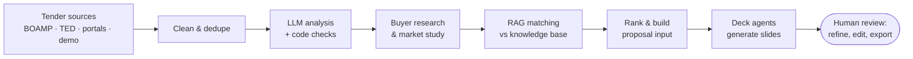

# OliveSoft RFP Intelligence

Finds public tenders, checks each requirement against OliveSoft's CVs and past projects, and drafts the proposal deck
for the ones worth bidding on. Built for CSTAM 3.0.

[Workflow](#workflow) · [Architecture](#architecture) · [Results](#results) · [Quick start](#quick-start) ·
[Demo](#demo-walkthrough) · [Tests](#tests) · [Docs](#documentation)

## The problem

A consulting firm answering public tenders spends most of its bid time on work that is not writing. Someone has to
watch portals like BOAMP and TED, read each notice to decide whether it fits, and break the specification into
concrete requirements: "3 senior data engineers", "PMP certified project manager", "prior experience in the public
sector".

Each requirement then needs proof. The evidence is scattered across CVs, project records and client lists, and a
claim the firm cannot back with a document is worse than an honest gap. Only after all of that does the proposal
deck get written, usually from scratch.

This repository automates that chain and keeps a person in charge of the final decisions.

## What it does

- **In:** tender sources (BOAMP / TED APIs, tender portals read through Firecrawl, or a synthetic demo feed) and the
  company knowledge base in [knowledge-base/](knowledge-base/) (19 PDF CVs, projects, tech stacks, clients, tools).
- **Processing:** an n8n pipeline cleans and analyses each tender with an LLM, verifies the LLM's answer in code,
  researches the buyer, and sends the requirements to a RAG service that returns covered / partial / missing per line,
  with the quoted evidence, a proposed team and the knowledge gaps.
- **Out:** a ranked list of tenders with a requirements matrix in the web app, and for the best tender a generated
  proposal deck that a person reviews, refines slide by slide and exports to PPTX or PDF.

## Workflow



Everything up to the deck runs automatically once **RFP - Main** is started from the n8n editor. The last step is
manual: in the web app a person reads the matrix, opens the deck, uses **Refine with AI** on individual slides,
edits in the studio editor and exports. The same flow as it looks in the n8n editor is in [n8n/README.md](n8n/README.md). Full node-by-node flow: [docs/n8n-pipeline.md](docs/n8n-pipeline.md).

## Key features

- **Two tender entry lanes, one tender object.** APIs are read by configuration only; arbitrary websites go through a
  scout agent whose links are mapped back to URLs the tool actually returned.
- **LLM output is verified, not trusted.** Quotes must appear in the tender text, unknown tender types are downgraded,
  and agent-written sentences with numbers not present in the data are removed.
- **Requirement-level evidence.** Each requirement gets a status, the cited document and a quoted proof line;
  headcounts, certificates, roles and seniority are checked by rules.
- **Team builder and gap report.** The RAG proposes a team that covers the needs and lists what the knowledge base
  cannot prove.
- **Six deck agents** in n8n: requirements and solution, architecture diagrams, planning and risks, budget scenarios,
  credibility, and a reviewer.
- **Human-in-the-loop editing.** Slide-level regeneration from an instruction, a full slide editor, native PPTX and
  PDF export, importable PowerPoint templates.
- **One LLM switch.** `LLM_PROVIDER` moves the whole system between Groq, Gemini, OpenAI and a local Ollama.

## Engineering choices worth a look

| Choice | Why it matters | Where |
|---|---|---|
| Hybrid retrieval (BM25 + multilingual E5, fused with RRF) | Keyword aliases and vectors cover each other's misses; French nDCG@5 rises from 0.75 (E5 alone) to 0.90 | [hybrid.py](services/rag/rag/hybrid.py) |
| Cross-encoder reranker on top candidates | Best top-3 precision of all systems compared | [index.py](services/rag/rag/index.py), [config.py](services/rag/rag/config.py) |
| Rules for counts, certificates, roles, seniority | Ranking alone cannot tell "mentions project management" from "holds the PMP"; CV decision checks go from 15/42 to 40/42 | [retriever.py](services/rag/rag/retriever.py), [reqparse.py](services/rag/rag/reqparse.py) |
| Decision set instead of a fixed top-k | Returns nothing for 5 of 6 impossible requirements; 95 % of accepted documents are relevant | [docs/rag-benchmark.md](docs/rag-benchmark.md#6-optimisation-what-each-design-choice-adds) |
| Agents decide, code states facts | Facts are built from tool results, never from the agent's own words | [docs/n8n-pipeline.md](docs/n8n-pipeline.md#three-agents-code-checks-what-they-say) |
| Code nodes kept as plain JS in `n8n/src/` and built into workflows | The pipeline logic is testable outside n8n (223 edge cases run in under a second) | [n8n/build.js](n8n/build.js), [docs/edge-cases.md](docs/edge-cases.md) |

## Architecture


| Component | Responsibility | Code |
|---|---|---|
| **web** | The only user interface: dashboard, tenders with their matrix, knowledge base editing, proposals, templates, quality page | [apps/web/](apps/web/) |
| **rag** | Indexes the knowledge base, matches requirements, builds teams and gap reports, stores analysed tenders, runs the benchmark | [services/rag/](services/rag/) |
| **n8n** | `RFP - Main` (tender pipeline, 62 nodes), its tool sub-workflows, `RFP - Refine Slide`, and the 9 deck-agent workflows | [n8n/](n8n/), [services/proposal-studio/workflows/](services/proposal-studio/workflows/) |
| **proposal-studio** | Tender inbox, deck layout engine, slide editor, PPTX / PDF export, templates; the deck agents' JavaScript logic | [services/proposal-studio/](services/proposal-studio/) |
| **demo-tenders** | Static server for synthetic tenders, so a demo always has fitting tenders | [n8n/demo/](n8n/demo/) |

The full description, including every pipeline node and the RAG internals, is in
[docs/architecture.md](docs/architecture.md). Contracts between services: [docs/integration-and-api.md](docs/integration-and-api.md).

## Results

All numbers below come from the existing reports in this repository (runs of 18–20 October 2026). They were not
re-run while writing this README.

**RAG retrieval** — 42 labelled tender requirements (11 in French) plus 6 negatives, over the company knowledge base.
Labels were written before any system was run. Source: [docs/rag-benchmark.md](docs/rag-benchmark.md).

| System | P@3 | MRR | nDCG@5 | Median latency |
|---|---|---|---|---|
| BM25 only | 0.79 | 0.99 | 0.90 | 12 ms |
| Dense E5-small | 0.80 | 0.94 | 0.83 | 34 ms |
| Hybrid (BM25 + E5) | 0.81 | 1.00 | 0.91 | 36 ms |
| Hybrid + reranker | 0.86 | 1.00 | 0.91 | 825 ms |
| **Final (rules + reranker)** | **0.81** | **1.00** | **0.90** | **237 ms** |

The final system ranks about as well as the hybrid baselines; what it adds is the decision. It returns an accepted
set rather than a top 5: set precision 0.95, set recall 0.73. It deliberately trades recall for precision, because
a wrong claim in a bid costs more than a missing one.

| Other evaluation | Result | Source |
|---|---|---|
| CV decision checks (headcounts, certificates, seniority) | 40/42 (similarity threshold: 8/42, reranker only: 15/42) | [results.md](services/rag/benchmark/results.md) |
| Real tender lines from a live n8n run | 30/39 correct status (28/39 before fixes; not independent evidence, see the report) | [docs/rag-benchmark.md §5.3](docs/rag-benchmark.md#53-real-tender-requirements-39-lines-n8n-live-run-3) |
| Pipeline edge cases (incomplete tenders, noisy research, LLM failures, missing references) | 223/223 pass | [docs/edge-cases.md](docs/edge-cases.md) |

The web app's **Quality** page shows the same reference results, including the RAG application test run (156 passed):


Limits stated in the benchmark report: one labeller, a small set, and a development set rather than a held-out one.

## Quick start

Needs Docker with Compose and about 10 GB of free disk (images are built locally), plus an LLM key (Groq by default)
or a local Ollama.

```bash
cp .env.example .env            # Windows: copy .env.example .env
# In .env: set STUDIO_API_KEY and AGENTS_WEBHOOK_KEY to two random strings (openssl rand -hex 24),
# and GROQ_API_KEY (or choose another LLM_PROVIDER)
docker compose up -d --build    # first build: 10-30 minutes (Python ML packages, models, Chromium)
docker compose ps               # wait until rag, proposal-studio and n8n are "healthy"
```

The first start builds the RAG index (a few minutes on CPU) and imports the n8n workflows (about a minute); follow it
with `docker compose logs -f rag n8n`. Then open http://localhost:5173.

Firecrawl is optional: without `FIRECRAWL_KEY` the portal sources are skipped and the BOAMP API still runs. Other LLM
providers, every setting, ports and troubleshooting: [docs/setup.md](docs/setup.md).

## Demo walkthrough

Screenshots from a run on the synthetic demo tenders (20 October 2026). More are in [docs/screenshots/](docs/screenshots/).

| | |
|---|---|
|  |  |
| **Tenders** ranked by relevance, with fit score, deadline and deck status | **Requirements matrix**: status, found / needed and the basis of each claim |
|  |  |
| **Generated deck** (19 slides) open in the studio editor | **Refine with AI** rewrites one slide from an instruction |

1. **Web app** (http://localhost:5173): the dashboard and knowledge base (CVs, projects, tech stacks) are served by the RAG.
2. **Find tenders:** in n8n (http://localhost:5679) open **RFP - Main** and click **Execute workflow**. For a demo that
   always has fitting tenders, set `PIPELINE_DEMO_MODE=true` in `.env` and run
   `docker compose up -d --force-recreate n8n` first. A run takes several minutes (LLM calls are paced for free tiers).
3. **Tenders:** every analysed tender appears in the web app with its requirements matrix, evidence, proposed team and
   knowledge gaps. Fitting tenders go to the studio inbox and the deck of the best one starts (`PIPELINE_AUTO_DECK=top1`).
4. **Deck:** the deck agents build it in n8n in about 4–5 minutes; follow progress on the tender page, then open the deck.
5. **Human in the loop:** on the deck page, **Refine with AI** rewrites one slide from an instruction; edit freely in
   the studio editor; export PPTX or PDF.

The demo tenders in [n8n/demo/demo_tenders.json](n8n/demo/demo_tenders.json) have fictional buyers marked "démo";
say so when presenting.

## Repository map

```text
apps/web/                  React + Vite + Tailwind web app (served by nginx in its container)
services/rag/              RAG service (FastAPI): matching, evidence, team builder, gaps, tender store, benchmark
services/proposal-studio/  Deck editor, layout engine, PPTX/PDF export, the 6 deck agents and their 9 n8n workflows
n8n/                       Tender pipeline: src/ (Code nodes) → build.js → dist/ (4 workflows), test/, demo/, init/
knowledge-base/            What the RAG reads: cvs/ (19 PDFs), projects/, tech_stacks/, clients/, tools/
docs/                      Architecture, contracts, benchmark, edge cases, setup
tests/README.md            Every test suite and its command
docker-compose.yml         The whole system; .env.example lists its settings
```

The proposal studio was written by a teammate as a standalone project; only a `Dockerfile`, `docker-entrypoint.sh`
and `.dockerignore` were added to its folder for the compose setup.

## Tests

Every suite runs through Docker from the repository root. Two examples:

```bash
docker run --rm -v "${PWD}/n8n:/w" -w /w node:20-alpine node test/edge_cases.js   # 223 pipeline edge cases, < 1 s
docker compose run --rm --no-deps rag python -m pytest                              # RAG application tests
```

The full list (RAG benchmark, studio Python and Node suites, adapter test, web type check) is in
[tests/README.md](tests/README.md), together with one known RAG test failure that is an artifact of the repository
move, not of the code.

## Data rules

- CVs come only from `knowledge-base/cvs/`; file names are preserved and API ids add `CV_`.
- Company records (`origin: user_entered`) come from the CVs and olivesoft.fr, and each one names its source. Demo
  records (`origin: demo`) are fictional, used only in Demo mode, and labelled as such everywhere.
- CV quotes are evidence; records are declarations and are never presented as document quotes.

## Limitations

- **Evaluation scale.** The benchmark sets are small and labelled by the system's author; the real-tender set comes
  from one live run, mostly on synthetic tenders.
- **Known matching misses.** Generic or French wording ("data restitutions") is under-scored by the reranker, and role
  vocabulary is narrow (a cloud infrastructure engineer is not read as DevOps). See [§7 of the benchmark](docs/rag-benchmark.md#7-failure-analysis).
- **Free-tier LLMs.** On Groq's free tier a pipeline run is paced to 15 s between calls and a deck uses about 36 000
  of the ~200 000 daily tokens.
- **Local only.** Ports are bound to 127.0.0.1 and the CORS origin is fixed to `http://localhost:5173`; there is no
  multi-user or deployment setup.
- **RFP - Main is started by hand** from the n8n editor; it is not published on a schedule.

## Documentation

| Document | Read it for |
|---|---|
| [docs/setup.md](docs/setup.md) | LLM providers, every `.env` setting, n8n start sequence, volumes, troubleshooting |
| [docs/architecture.md](docs/architecture.md) | The system, every node and data flow of the pipeline, the RAG service internals |
| [docs/integration-and-api.md](docs/integration-and-api.md) | Contracts between services and the API reference of the RAG, the studio and the n8n webhooks |
| [docs/n8n-pipeline.md](docs/n8n-pipeline.md) | What the pipeline does, its three agents and code checks, demo mode |
| [docs/rag-service.md](docs/rag-service.md) | Data modes, adding company knowledge, how matching decides, storage |
| [docs/rag-benchmark.md](docs/rag-benchmark.md) | RAG evaluation: method, ablation, results, failure analysis, limits |
| [docs/edge-cases.md](docs/edge-cases.md) | The pipeline's edge-case suite and the gaps it found |
| [tests/README.md](tests/README.md) | Every test suite and its command |
| [services/proposal-studio/README.md](services/proposal-studio/README.md) | The studio's own documentation (written for running it standalone) |
| [docs/design/](docs/design/), [docs/presentation/](docs/presentation/), [docs/team/](docs/team/) | Product UX notes, knowledge base guide, team notes |
| [docs/competition/](docs/competition/) | The CSTAM book (rules, scoring) and team task assignment |
