# OliveSoft RFP Intelligence

Finds public tenders, checks each requirement against OliveSoft's CVs and past projects, and drafts the proposal deck
for the ones worth bidding on. Built for the CSTAM 3.0 challenge.

[Workflow](#workflow) · [Screenshots](#what-it-looks-like) · [Architecture](#architecture) · [Results](#results) ·
[Quick start](#quick-start) · [Tests](#tests)

**Reports:** [Evaluation report](docs/evaluation-report.md) · [RAG benchmark](docs/rag-benchmark.md) ·
[Edge cases](docs/edge-cases.md) · [Deck agents evaluation](services/proposal-studio/docs/agents/EVAL_REPORT.md)

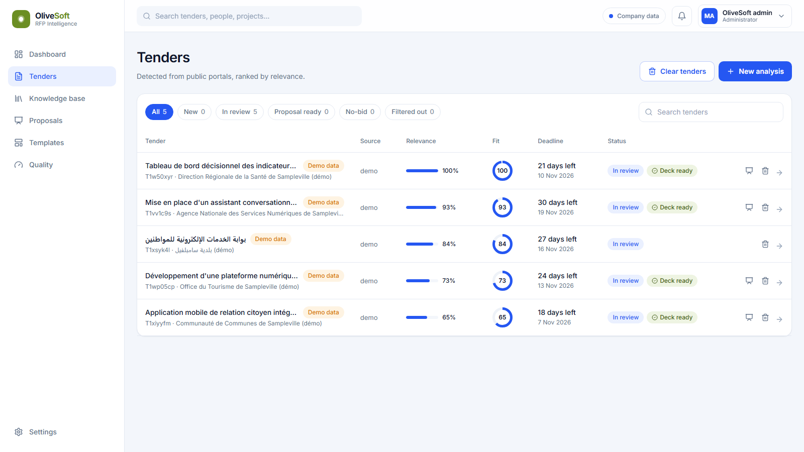

## The problem

A consulting firm answering public tenders spends most of its bid time on work that is not writing. Someone has to
watch portals like BOAMP and TED, read each notice to decide whether it fits, and break the specification into
concrete requirements: "3 senior data engineers", "PMP certified project manager", "a health sector reference".

Each requirement then needs proof. The evidence is scattered across CVs, project records and client lists, and a
claim the firm cannot back with a document is worse than an honest gap. Only after all of that does the proposal deck
get written, usually from scratch.

This repository automates that chain and leaves the final decisions to a person.

## What it does

- **In:** tender sources (the BOAMP API, tender portals read through Firecrawl, and an optional demo feed) and the
  company knowledge base in [knowledge-base/](knowledge-base/): 19 PDF CVs, projects, tech stacks, clients and tools.
- **Processing:** an n8n pipeline cleans each tender and analyses it with an LLM, then checks the LLM's answer in code.
  It researches the buyer and the market, and sends the requirements to a RAG service. For each line the RAG returns
  covered / partial / missing, the quoted evidence, a proposed team and the knowledge gaps.
- **Out:** a ranked list of tenders in the web app, each with its requirements matrix. For the best tender, six deck
  agents generate a proposal deck on an OliveSoft template. A person reviews it, refines it slide by slide and
  exports it to PPTX or PDF.

## Workflow

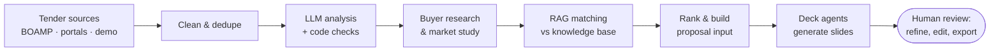

Everything up to the deck runs automatically once **RFP - Main** is started from the n8n editor. In the evaluated runs
it went from detection to a finished deck with no manual step in between. The last step is manual: a person reads the
matrix, opens the deck, uses **Refine with AI** on individual slides, edits in the studio editor and exports.
Node-by-node description: [docs/n8n-pipeline.md](docs/n8n-pipeline.md). The canvases: [n8n/README.md](n8n/README.md).

## What it looks like

All screenshots below were taken on the running system on 20 October 2026.

| | |
|---|---|
| 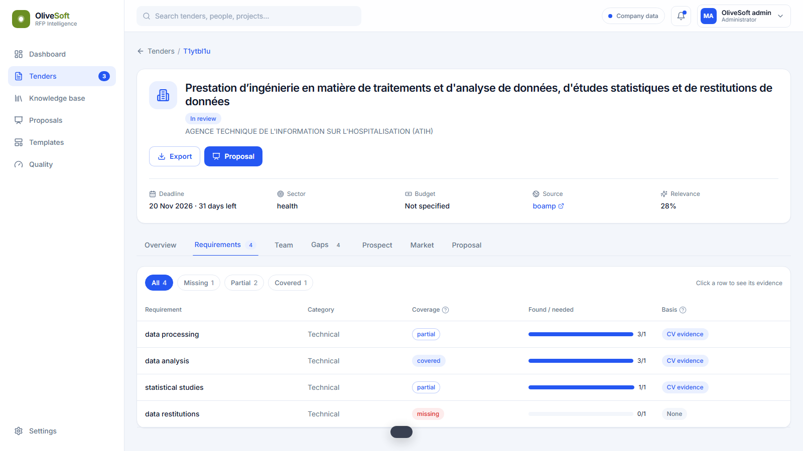 | 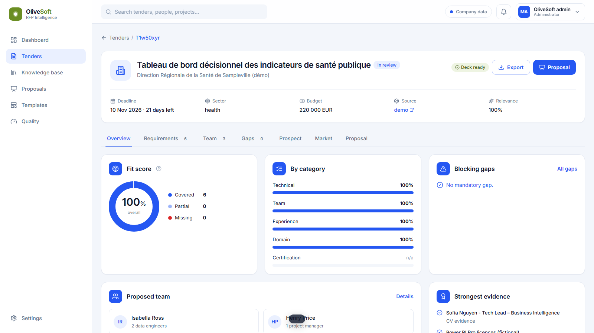 |
| **Requirements matrix** of a real BOAMP tender (ATIH): one row per requirement, its coverage and the basis of each claim. "data restitutions" is honestly reported missing | **Overview** of the same tender: fit score, blocking gaps with the reason for each, and the strongest CV evidence |
| 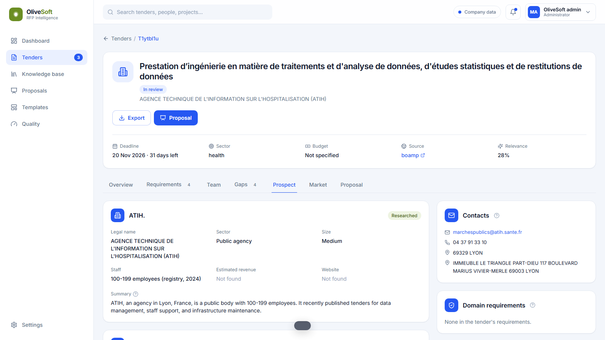 | 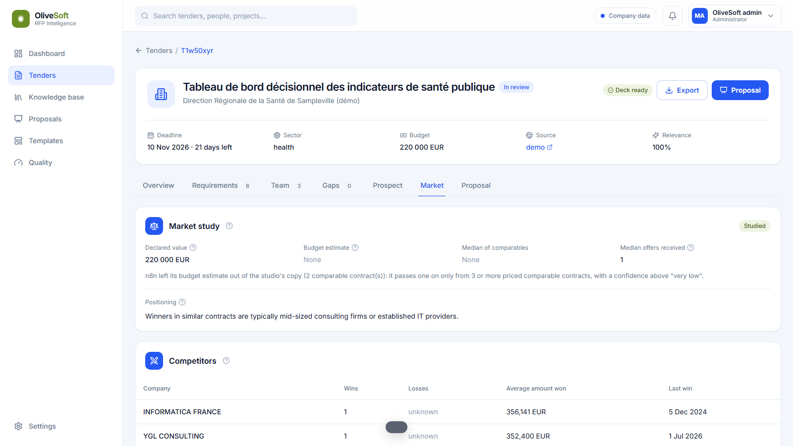 |
| **Prospect:** buyer profile and contacts from public registries | **Market:** comparable awarded contracts, typical winners, budget range |
| 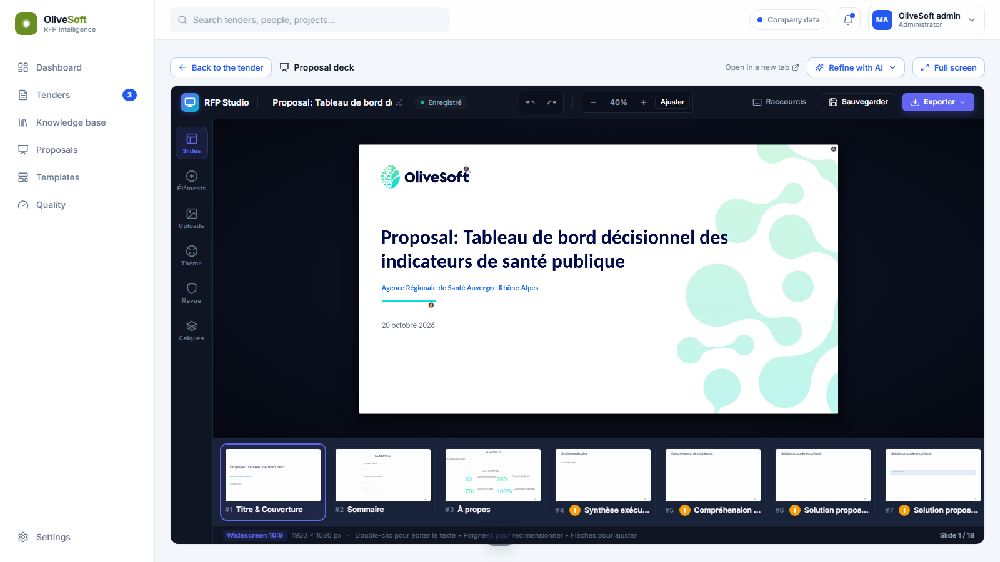 | 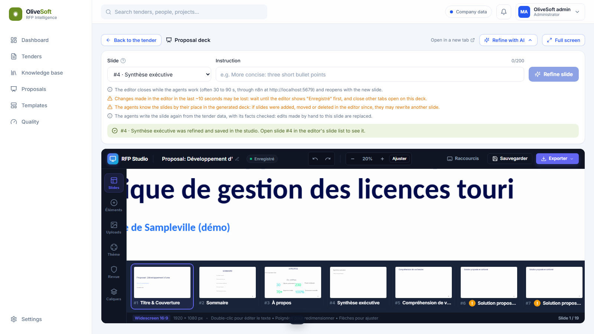 |
| **Generated deck** (18 slides) on OliveSoft template 1, open in the editor | **Refine with AI:** one slide rewritten from an instruction and saved |

A full exported deck is in [docs/samples/](docs/samples/) as [PPTX](docs/samples/sample-deck.pptx) and
[PDF](docs/samples/sample-deck.pdf). [docs/evaluation-report.md §4](docs/evaluation-report.md#4-deck-quality) reviews
it, including what a reviewer still has to fix. All screenshots: [docs/screenshots/](docs/screenshots/).

| Title slide | Executive summary | Implementation plan |
|---|---|---|
| 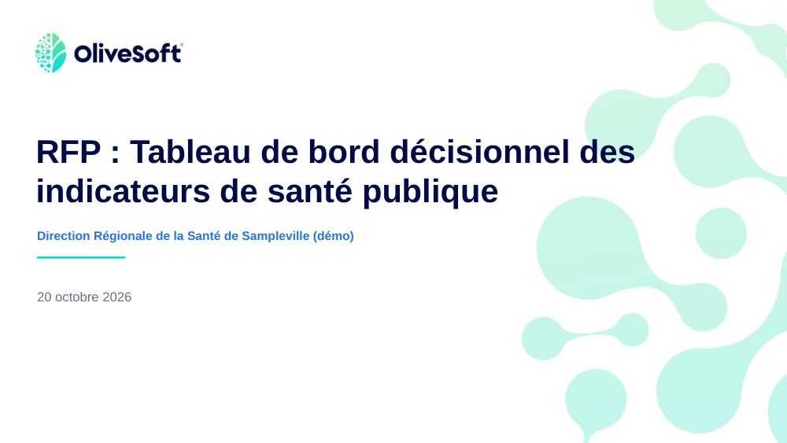 | 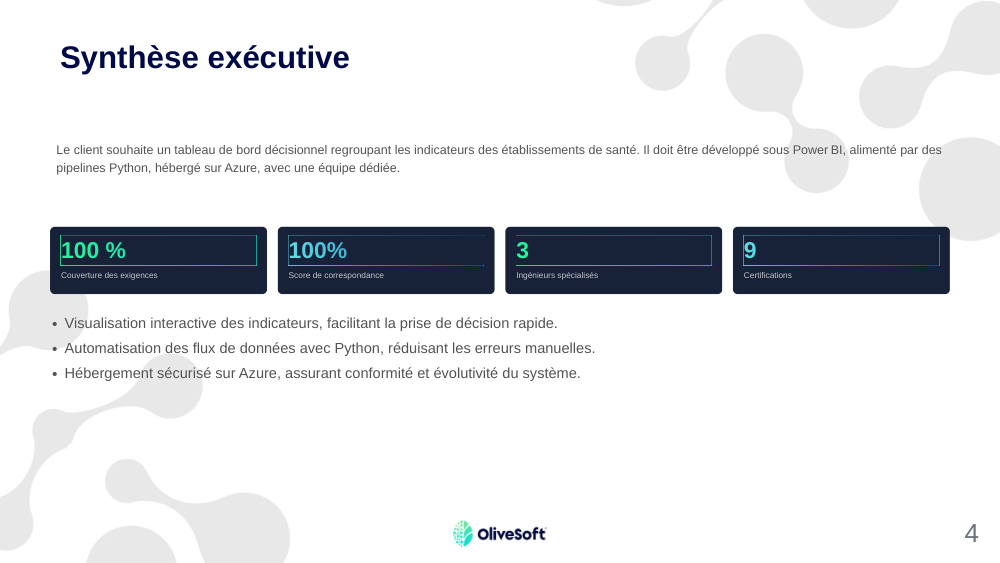 | 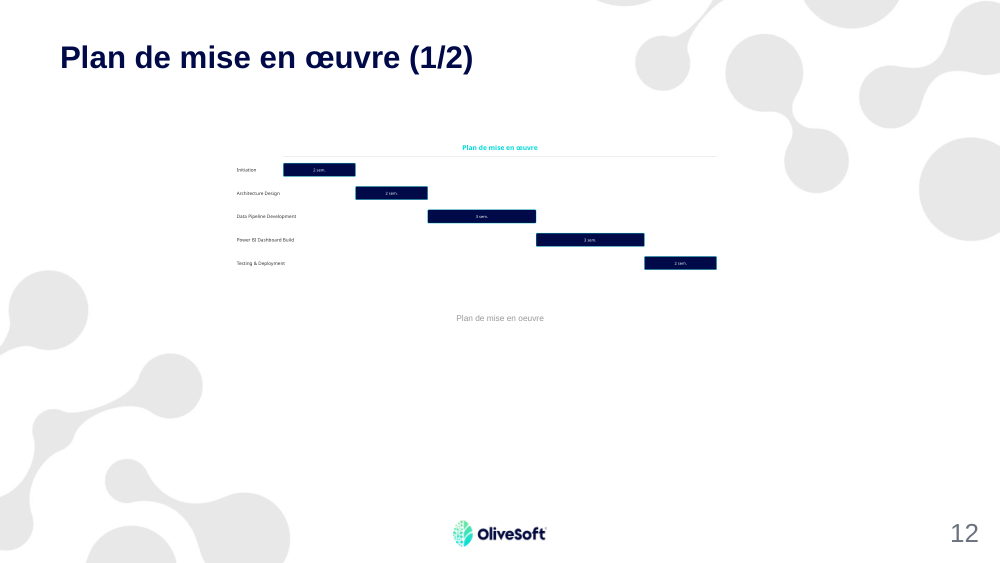 |

## Engineering choices worth a look

| Choice | Why it matters | Where |
|---|---|---|
| Hybrid retrieval (BM25 + multilingual E5, fused with RRF) | Keyword aliases and vectors cover each other's misses. French nDCG@5 goes from 0.75 (E5 alone) to 0.90 | [hybrid.py](services/rag/rag/hybrid.py) |
| Cross-encoder reranker on top candidates | Best top-3 precision of the systems compared | [index.py](services/rag/rag/index.py), [config.py](services/rag/rag/config.py) |
| Rules for counts, certificates, roles, seniority | Ranking alone cannot tell "mentions project management" from "holds the PMP". CV decision checks go from 15/42 to 40/42 | [retriever.py](services/rag/rag/retriever.py), [reqparse.py](services/rag/rag/reqparse.py) |
| Decision set instead of a fixed top-k | Returns nothing for 5 of 6 impossible requirements; 95 % of the documents it accepts are relevant | [rag-benchmark.md §6](docs/rag-benchmark.md#6-optimisation-what-each-design-choice-adds) |
| Agents decide, code states facts | Facts come from tool results, never from the agent's own words. LLM quotes must appear in the tender text | [n8n-pipeline.md](docs/n8n-pipeline.md#three-agents-code-checks-what-they-say) |
| Code nodes as plain JS in `n8n/src/`, built into workflows | The pipeline logic is tested outside n8n: 223 edge cases run in under a second | [n8n/build.js](n8n/build.js), [edge-cases.md](docs/edge-cases.md) |

## Architecture

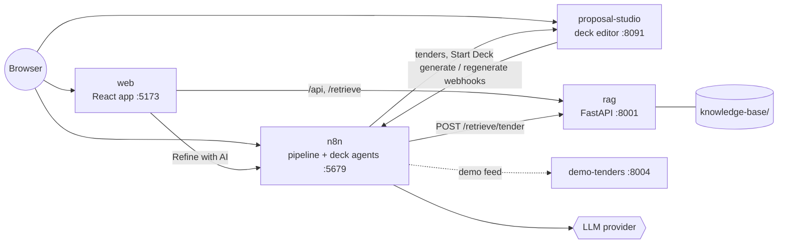

| Component | Responsibility | Code |
|---|---|---|
| **web** | The only user interface: dashboard, tenders and their tabs, knowledge base editing, proposals, templates, Quality page | [apps/web/](apps/web/) |
| **rag** | Indexes the knowledge base, matches requirements, builds teams and gap reports, stores analysed tenders, runs the benchmark | [services/rag/](services/rag/) |
| **n8n** | Runs `RFP - Main` (tender pipeline, 62 nodes with 3 agents), its tool sub-workflows, `RFP - Refine Slide`, and the 9 deck-agent workflows | [n8n/](n8n/), [services/proposal-studio/workflows/](services/proposal-studio/workflows/) |
| **proposal-studio** | Tender inbox, deck layout engine, slide editor, PPTX / PDF export, templates, and the deck agents' JavaScript logic | [services/proposal-studio/](services/proposal-studio/) |
| **demo-tenders** | Serves the demo tenders, so a demo always has fitting tenders | [n8n/demo/](n8n/demo/) |

Full description: [docs/architecture.md](docs/architecture.md). Contracts and APIs: [docs/integration-and-api.md](docs/integration-and-api.md).

## Results

From [docs/evaluation-report.md](docs/evaluation-report.md), measured on 2026-10-20 with the packaged system.

**RAG retrieval.** The test set is 42 labelled tender requirements (11 in French) plus 6 negatives, over the company
knowledge base. Labels were written before any system was run. Method and failure analysis: [docs/rag-benchmark.md](docs/rag-benchmark.md).

| System | nDCG@5 | P@3 | MRR |
|---|---|---|---|
| BM25 only | 0.90 | 0.79 | 0.99 |
| Dense E5-small | 0.83 | 0.80 | 0.94 |
| Hybrid (BM25 + E5) | 0.91 | 0.81 | 1.00 |
| Hybrid + reranker | 0.91 | 0.86 | 1.00 |
| **Final (rules + reranker)** | **0.90** | **0.81** | **1.00** |

The final system ranks about as well as the hybrid baselines. What it adds is the decision: it returns an accepted set,
with set precision 0.95 and set recall 0.73. It trades recall for precision on purpose, because a wrong claim in a bid
costs more than a missing one. It takes about 1 s per requirement on CPU in the container.

| Evaluation | Result |
|---|---|
| CV decision checks (headcounts, certificates, seniority) | **40/42** (similarity threshold 8/42, reranker only 15/42) |
| Real tender lines sent by n8n in a live run | **30/39** correct status; a development set, not independent evidence |
| End-to-end run, Main on Ollama and decks on Groq | 18 tenders extracted, 5 fit, 0 failed calls; 18-slide deck in 137 s, 25 707 tokens |
| End-to-end run, Groq for everything | Deck in 172 s; 2 analyses and every market study hit Groq's free-tier rate limit |
| Refine with AI (Groq) | Slide rewritten and saved in 10–20 s |

**Executed test suites** (2026-10-20; commands in [tests/README.md](tests/README.md)):

| Suite | Result |
|---|---|
| Pipeline edge cases | 223 / 223 pass |
| Studio adapter (11 recorded proposal inputs) | all checks pass |
| RAG application tests | 202 passed, 1 deselected (repository-layout artifact) |
| Proposal studio, Python | 126 OK, 12 slow browser tests skipped |
| Proposal studio, deck agents (Node) | 373 / 373 pass |
| Web app (`tsc -b` strict + `vite build`) | pass |

The web app's **Quality** page shows the benchmark and the reference test run shipped with the RAG service:

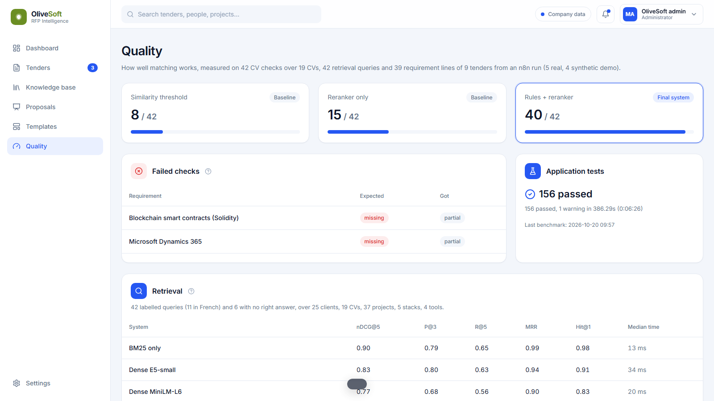

## Quick start

You need Docker with Compose, about 10 GB of free disk (the images are built locally), and either an LLM key (Groq by
default) or a local Ollama.

```bash
cp .env.example .env            # Windows: copy .env.example .env
# In .env: set STUDIO_API_KEY and AGENTS_WEBHOOK_KEY to two random strings (openssl rand -hex 24),
# and GROQ_API_KEY (or choose another LLM_PROVIDER)
docker compose up -d --build    # first build: 10-30 minutes (Python ML packages, models, Chromium)
docker compose ps               # wait until rag, proposal-studio and n8n are "healthy"
```

The first start builds the RAG index (a few minutes on CPU) and imports and publishes the 13 n8n workflows. Follow it
with `docker compose logs -f rag n8n`.

| URL (127.0.0.1 only) | Service |
|---|---|
| http://localhost:5173 | **The web app.** Keep exactly this origin: the RAG CORS setting and the refine webhook allow only it |
| http://localhost:5679 | n8n editor (create the owner account on the first visit) |
| http://localhost:8091 | Proposal studio |
| http://localhost:8001/docs | RAG API reference |
| http://localhost:8004/tenders | Demo tenders |

### Run a demo

1. In n8n, open **RFP - Main** and click **Execute workflow**. A run takes several minutes, because LLM calls are paced
   for free tiers.
2. Every analysed tender appears in the web app's **Tenders** page with its matrix, team, gaps, prospect and market tabs.
   The deck of the best tender starts by itself (`PIPELINE_AUTO_DECK=top1`) and takes 2–3 minutes with Groq.
3. Open the deck, try **Refine with AI** on a slide, then export PPTX or PDF from the editor.

### Main settings

| Setting | Values |
|---|---|
| `LLM_PROVIDER` | `groq` (default, `GROQ_API_KEY`), `gemini`, `openai`, `ollama` (`OLLAMA_URL`). `LLM_MODEL` overrides the default model |
| `DECK_LLM_PROVIDER` | Gives the deck agents a different LLM from Main. The tested setup is Main on `ollama` and decks on `groq` |
| `PIPELINE_DEMO_MODE` | `false`: real sources only. `true`: demo tenders only. `with`: both |
| `PIPELINE_PRESET` | `test` (small limits) or `production`. Empty: n8n decides (editor runs use `test`) |
| `FIRECRAWL_KEY` | Enables the portal sources and buyers' web pages. Without it, the BOAMP API still runs |

Every setting is documented in [.env.example](.env.example). After changing `.env`, run
`docker compose up -d --force-recreate n8n proposal-studio`; no rebuild is needed. The demo tenders use real public
bodies as buyers but are fictional, and the web app labels them "Demo data". Say so when presenting.

### Troubleshooting

| Symptom | Fix |
|---|---|
| n8n restarts in a loop | `docker compose logs n8n` shows a `CONFIGURATION ERROR` line naming the `.env` value to fix |
| "The RAG service is not reachable" | The first start is still building the index. Wait for `rag` to be healthy |
| Deck generation returns 502 or stays queued | n8n's webhooks are not published yet. Set `RFP_FORCE_IMPORT=1` and recreate n8n |
| Refine with AI gets no answer | Open the app at `http://localhost:5173`, not `127.0.0.1` |
| LLM errors 429 / quota | The free tier is exhausted. Change `LLM_MODEL` or `LLM_PROVIDER` and recreate n8n and the studio |
| Start from zero | `docker compose down -v` deletes every volume: tenders, decks and the n8n database |

## Repository map

```text
apps/web/                  React + Vite + Tailwind web app (served by nginx in its container)
services/rag/              RAG service (FastAPI): matching, evidence, team builder, gaps, tender store, benchmark
services/proposal-studio/  Deck editor, layout engine, PPTX/PDF export, the 6 deck agents and their 9 n8n workflows
n8n/                       Tender pipeline: src/ (Code nodes) → build.js → dist/ (4 workflows), test/, demo/, init/
knowledge-base/            What the RAG reads: cvs/ (19 PDFs), projects/, tech_stacks/, clients/, tools/
docs/                      Evaluation report, architecture, contracts, benchmark, edge cases, screenshots, sample deck
tests/README.md            Every test suite and its command
docker-compose.yml         The whole system; .env.example lists its settings
```

A teammate wrote the proposal studio as a standalone project. Only a `Dockerfile`, `docker-entrypoint.sh` and
`.dockerignore` were added to its folder for the compose setup.

## Tests

Every suite runs through Docker from the repository root. Two examples:

```bash
docker run --rm -v "${PWD}/n8n:/w" -w /w node:20-alpine node test/edge_cases.js   # 223 pipeline edge cases, < 1 s
docker compose run --rm --no-deps rag python -m pytest \
  --deselect tests/test_review_fixes.py::test_tender_inbox_is_ignored_by_git     # RAG application tests
```

[tests/README.md](tests/README.md) has the full list and explains the deselected test.

## Data rules

- CVs come only from `knowledge-base/cvs/`.
- Company records (`origin: user_entered`) come from the CVs and olivesoft.fr, and each one names its source.
- Demo records (`origin: demo`) are fictional. They are used only in Demo mode and labelled everywhere they appear.
- CV quotes are evidence. Records are declarations and are never presented as document quotes.

## Limitations

- **Evaluation scale.** The benchmark sets are small and were labelled by the system's author. They are development
  sets, not a held-out set.
- **Matching misses.** Generic or French wording ("data restitutions") and team-size lines are sometimes reported
  missing where partial would be right.
- **Decks still need review.** Each deck has 2–3 `[TO FILL]` placeholders, and some English fragments appear in French
  decks. Prices come from a catalogue and must be approved before export. See [evaluation report §4](docs/evaluation-report.md#4-deck-quality).
- **Free-tier LLMs.** With one Groq key for everything, Main is paced and can still be rate limited.
- **Demo buyers are not researched.** Buyer research was verified on real tenders only.
- **Local only.** There is no multi-user or deployment setup, and RFP - Main is started by hand.

Full list: [evaluation report §8](docs/evaluation-report.md#8-known-limitations).

## Documentation

| Document | Read it for |
|---|---|
| [docs/evaluation-report.md](docs/evaluation-report.md) | **Start here:** benchmark, end-to-end runs, deck quality, refine loop, test results, specification coverage |
| [docs/architecture.md](docs/architecture.md) | The system, every node and data flow of the pipeline, the RAG service internals |
| [docs/integration-and-api.md](docs/integration-and-api.md) | Contracts between services; API reference of the RAG, the studio and the n8n webhooks |
| [docs/n8n-pipeline.md](docs/n8n-pipeline.md) | What the pipeline does, its three agents and code checks, the proposal input |
| [docs/rag-service.md](docs/rag-service.md) | Data modes, adding company knowledge, how matching decides |
| [docs/rag-benchmark.md](docs/rag-benchmark.md) | RAG evaluation: method, ablation, failure analysis, limits |
| [docs/edge-cases.md](docs/edge-cases.md) | The pipeline's edge-case suite and the gaps it found |
| [services/proposal-studio/docs/agents/EVAL_REPORT.md](services/proposal-studio/docs/agents/EVAL_REPORT.md) | The deck agents' own evaluation report (teammate) |
| [tests/README.md](tests/README.md) | Every test suite and its command |
| [n8n/README.md](n8n/README.md), [services/rag/README.md](services/rag/README.md), [apps/web/README.md](apps/web/README.md) | Component guides |
| [services/proposal-studio/README.md](services/proposal-studio/README.md) | The studio's own documentation (written for running it standalone) |
| [docs/competition/](docs/competition/) | The CSTAM book (rules, scoring) and the team task assignment |
