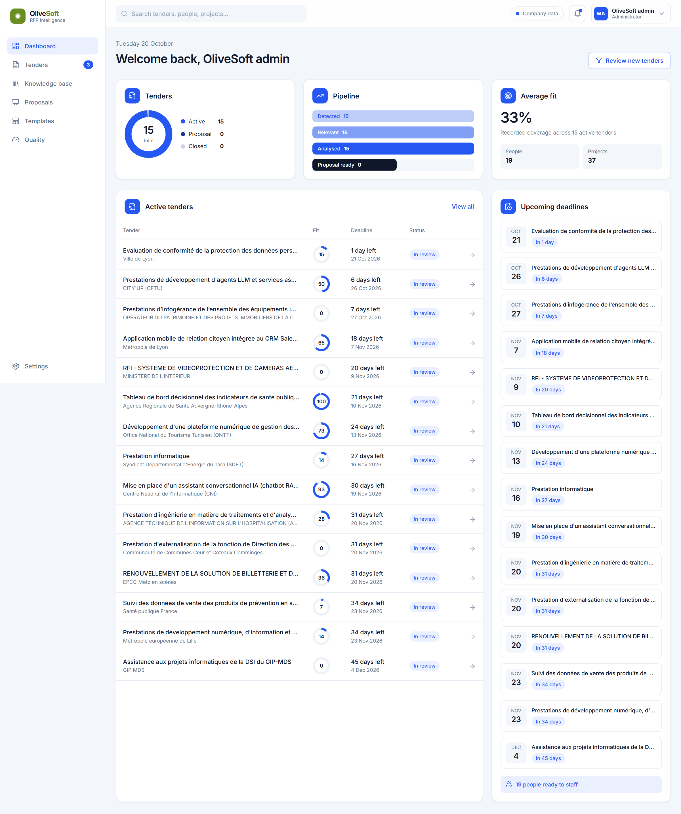
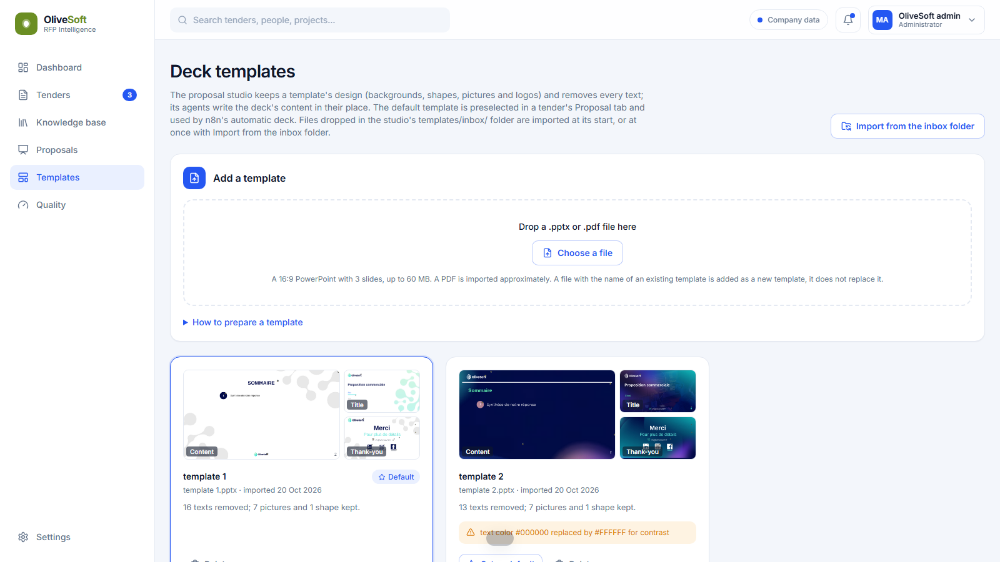
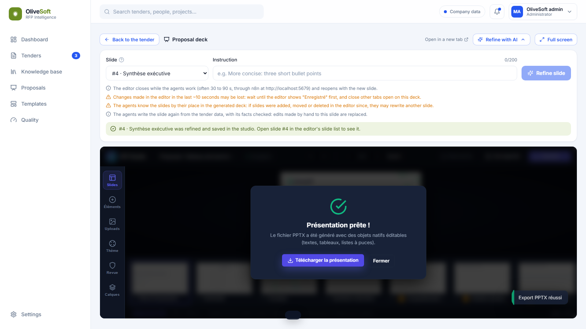

# Web app

The user interface of the system: dashboard, tenders with their requirements matrix, evidence, team and gaps,
knowledge base editing, proposals and decks (with "Refine with AI"), templates, and a Quality page showing the RAG
benchmark. React 18 + Vite + Tailwind, served by nginx in the `web` container on http://localhost:5173.



| | |
|---|---|
|  |  |
| **Templates**: imported PowerPoint designs; the agents write into them | **Export**: native, editable PPTX from the embedded editor |

The tender tabs (overview, requirements, prospect, market) and the deck page are shown in the [root README](../../README.md#what-it-looks-like).

## How it fits

- `/api`, `/retrieve`, `/health` go to the RAG service (nginx in the container, the Vite proxy in development).
- The proposal studio and n8n are called from the browser at `VITE_STUDIO_URL` (default `http://localhost:8091`) and
  `VITE_N8N_URL` (default `http://localhost:5679`), set as build arguments in [docker-compose.yml](../../docker-compose.yml).
- The origin must stay `http://localhost:5173`: the RAG CORS setting and the Refine Slide webhook allow only that origin.

## Code

| Path | Role |
|---|---|
| [src/main.tsx](src/main.tsx) | Routes |
| [src/pages/](src/pages/) | `Dashboard`, `Tenders`, `TenderWorkspace` (one tender), `Knowledge`, `DeckView`, `Templates`, `Other` (Proposals, Quality, Settings) |
| [src/lib/api.ts](src/lib/api.ts) | RAG client; [studio.ts](src/lib/studio.ts) and [refine.ts](src/lib/refine.ts) call the studio and n8n |
| [src/components/](src/components/) | Layout and shared UI |

## Run and check

```bash
docker compose build web      # tsc -b (strict) then vite build
npm install && npm run dev    # local development; expects the RAG on 127.0.0.1:8001
```

Design notes: [docs/design/Product_UX_and_Design_System.md](../../docs/design/Product_UX_and_Design_System.md).
