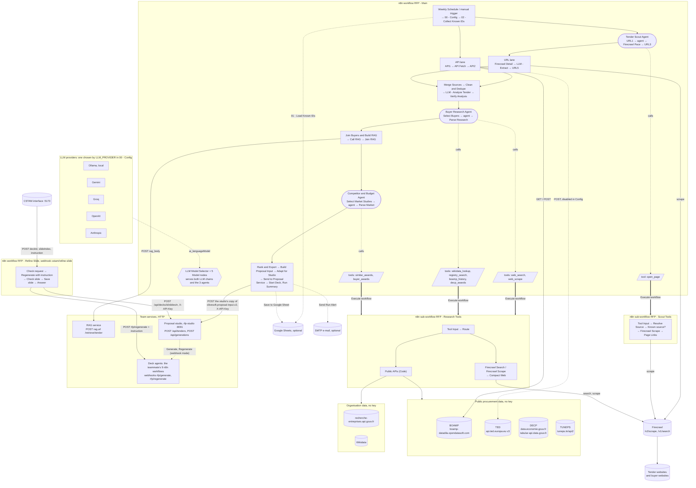
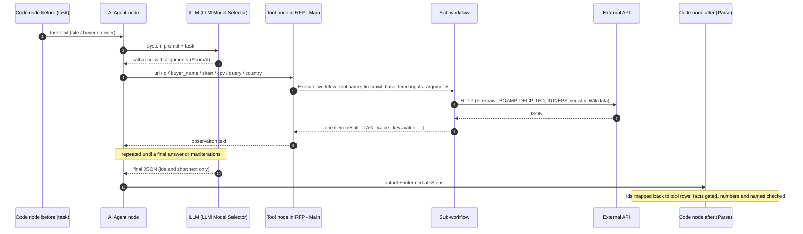
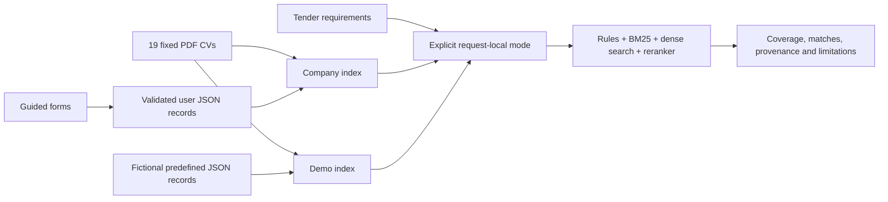

# Architecture

OliveSoft RFP Intelligence is five containers started by `docker compose up` (see the [README](../README.md)):

```text
browser ── http://localhost:5173  web (nginx: apps/web) ──/api, /retrieve, /health──► rag:8001 (services/rag, knowledge-base/)
   ├────── http://localhost:8091  proposal-studio (services/proposal-studio: deck editor, tender inbox, PPTX / PDF export)
   └────── http://localhost:5679  n8n ── webhook cstam/refine-slide ("Refine with AI" on one slide)
n8n "RFP - Main" (n8n/): BOAMP / TED APIs, portals through Firecrawl, demo-tenders:8004 ──► analysis LLM + code checks
   ──► rag:8001/retrieve/tender (requirements matrix, evidence, team, gaps; stored for the web app)
   ──► buyer research + market study ──► proposal input ──► proposal-studio:8091/api/tenders ──► "Start Deck" (rank 1)
proposal-studio ── POST n8n:5678/webhook/rfp/generate ──► the deck agents (6 agents, 9 n8n workflows) ──► deck saved in the studio
web app "Refine with AI" ──► n8n "RFP - Refine Slide" ──► agents' "RFP 60 Regenerate" ──► studio slide route
```

| Container | Code | Port (host 127.0.0.1) | State (Docker volumes) |
|---|---|---|---|
| `web` | `apps/web` (React 18, Vite, Tailwind; nginx in production) | 5173 | none |
| `rag` | `services/rag` (FastAPI, Chroma, BM25 + multilingual-e5-small + mmarco cross-encoder, rules) | 8001 | `rag_state` (tender store), `rag_index`; `knowledge-base/` bind-mounted |
| `proposal-studio` | `services/proposal-studio` (Python `server.py`, Node agents, Playwright Chromium) | 8091 | `studio_*` (saves, tenders, generations, exports, uploads, templates) |
| `n8n` | `n8n/` (our 4 workflows) + `services/proposal-studio/workflows` (the agents' 9), n8n 2.41.3 | 5679 | `n8n_data` (database, credentials, agents' registry) |
| `demo-tenders` | `n8n/demo/server.js` (synthetic tenders) | 8004 | none |

The LLM: one setting, `LLM_PROVIDER` (groq, gemini, openai or ollama), drives Main's model node and credential and the
deck agents' OpenAI-compatible client (`GROQ_BASE_URL` / `GROQ_API_KEY` / `GROQ_MODEL`); `n8n/init/init.js` computes
both at every n8n start from `n8n/llm.json`. Contracts between the parts: [integration-and-api.md](integration-and-api.md).

The URLs in the n8n workflows: `n8n/src/main/00_config.js` and `n8n/src/refine/check_request.js` keep stand-alone
defaults (`host.docker.internal:8001` / `:8091` / `:8004`, for an n8n container next to services started by hand);
in this repository `n8n/init/init.js` replaces them at import with the compose service names (`rag`, `proposal-studio`,
`demo-tenders`), and the image build fails if a replacement no longer applies.

---

# Part 1 — The n8n pipeline

This is the architecture and data-flow reference of the n8n part of the OliveSoft RFP pipeline: what runs where, which
external systems it calls, how one tender becomes a proposal input, and what every node of `RFP - Main` does. Everything
here was written from the code: `n8n/build.js` (nodes, wiring, prompts, timeouts) and `n8n/src/main/*.js`, `n8n/src/tools/*.js`
(the Code nodes). [n8n-pipeline.md](n8n-pipeline.md) covers what it does and how to configure it. [integration-and-api.md](integration-and-api.md) holds the
contracts of the two team services.

- [1. System architecture](#1-system-architecture)
- [2. How an agent tool call works](#2-how-an-agent-tool-call-works)
- [3. Data flow of one tender](#3-data-flow-of-one-tender)
- [4. Node reference: RFP - Main](#4-node-reference-rfp---main)
- [5. Node reference: the two sub-workflows](#5-node-reference-the-two-sub-workflows)
- [6. Node reference: RFP - Refine Slide](#6-node-reference-rfp---refine-slide)
- [7. Design choices](#7-design-choices)

## 1. System architecture

Four n8n workflows are built from `src/` by `node build.js` into `dist/`:

| workflow | nodes | role |
|---|---|---|
| `RFP - Main` | 62 (+ 7 canvas notes) | the pipeline: two entry lanes, cleaning, analysis, 3 agents, RAG call, ranking, hand-off |
| `RFP - Scout Tools` | 5 | the `open_page` tool of the Tender Scout Agent (Firecrawl + numbered links; hosts of no configured source refused) |
| `RFP - Research Tools` | 6 | the 8 tools of the Buyer Research Agent and of the Competitor & Budget Agent |
| `RFP - Refine Slide` | 11 (+ 1 canvas note) | Human-in-the-Loop refinement: one slide rewritten by the deck agents with a sales person's instruction, then saved in the studio (webhook `cstam/refine-slide`) |



How to read it:

- **Two entry lanes, one tender object.** The API lane reads public JSON APIs (BOAMP; TED is configured but disabled) by
  configuration only. The URL lane reads any website: the Tender Scout Agent opens pages with `open_page`, then Firecrawl
  reads each tender page and an LLM fills the fields. From `Merge Sources` on, every tender takes the same path.
- **Three agents, each with its own tools.** A tool node in `RFP - Main` (n8n "Call n8n Workflow Tool") calls a
  sub-workflow: `open_page` calls `RFP - Scout Tools` (id `kJh2xit7vcFVsP7i` in `build.js`), the 8 research and market
  tools call `RFP - Research Tools` (id `QHV4m1jKm8fKBXNA`). The `Route` switch sends `web_search` / `web_scrape` to
  Firecrawl and every other tool to the `Public APIs` Code node.
- **External sources.** BOAMP (API lane and `boamp_history`), TED (API lane when enabled, `similar_awards`,
  `buyer_awards`), DECP (`decp_awards` on data.economie.gouv.fr dataset `decp-2022-marches-valides`; the market tools on the
  consolidated DECP of tabular-api.data.gouv.fr), TUNEPS (market tools, Tunisia), recherche-entreprises (`registry_search`),
  Wikidata (`wikidata_lookup`), Firecrawl (every page read and web search). The public sources need no key; Firecrawl uses
  an n8n Header Auth credential and each LLM provider its own credential.
- **LLM providers.** One `LLM Model Selector` serves the model chosen by `LLM_PROVIDER` in `00 - Config` to the five LLM
  users: Tender Scout Agent, LLM - Extract, LLM - Analyze Tender, Buyer Research Agent, Competitor & Budget Agent. Models in
  `build.js`: Ollama `qwen3:4b-instruct`, Gemini `models/gemini-3.1-flash-lite`, Groq `openai/gpt-oss-120b`, OpenAI
  `gpt-4.1-mini`, Anthropic `claude-haiku-5-5`, all at temperature 0.
- **Team services.** `Call RAG` posts the verified requirements of each fit tender to the RAG service and `Join RAG` reads
  its matrix. `Adapt for Studio` makes the proposal studio's copy of each `olivesoft.proposal-input.v2` (no demo record
  or weak proof shown as proof, the proposed team, no unsupported budget), `Send to Proposal Service` stores it in the
  studio's tender inbox (credential "Proposal Studio key") and `Start Deck` starts the deck of the rank-1 tender
  (`proposal.autoDeck: 'top1'`). The studio runs its deck agents itself (cli mode) or calls the teammate's 9 n8n
  workflows through their webhooks (webhook mode, in the same n8n as ours). Both contracts: [integration-and-api.md](integration-and-api.md).
- **Human in the loop.** `RFP - Refine Slide` takes one slide and an instruction from the CSTAM interface, has the deck
  agent that owns the slide rewrite it (the agents' regenerate webhook, which accepts an instruction) and saves the
  result through the studio's slide route; only a new slide is saved. Contract: [integration-and-api.md §4.4](integration-and-api.md#44-refine-with-ai).

### Run presets (00 - Config)

A manual run uses the `test` preset, the weekly schedule the `production` preset (`FORCE_PRESET` overrides).

| limit | test | production | what it bounds |
|---|---|---|---|
| `maxRecordsPerApi` | 20 | 300 | records read per API source |
| `maxPagesPerUrl` | 1 | 3 | list pages per URL source (also capped by the source's `maxPages`) |
| `maxTendersPerUrlSource` | 5 | 40 | tender pages scraped per URL source |
| `maxBuyersToResearch` | 3 | 40 | Buyer Research Agent runs |
| `maxMarketStudies` | 3 | 15 | Competitor & Budget Agent runs |
| `skipKnown` | false | true | skip tenders exported by a previous run, and URL notices it found expired (deadline passed), awarded, cancelled or superseded (needs the Google Sheet nodes) |

Fixed limits for both: `lookbackDays` 30, `staleNoDeadlineDays` 90, `tooLateDays` 3, `scoutMaxLinks` 100,
`extractMaxChars` and `analysisMaxChars` 10 000, `maxListHops` 2; `proposal.maxTenders` 10; `llm.delayMs` 0 for Ollama,
4 000 ms for cloud providers; `firecrawl.intervalMs` 6 500 ms. `today` is the date in the workflow's time zone (n8n `$now`:
the workflow setting, else `GENERIC_TIMEZONE`), not the UTC date: expiry, `days_left` and the API lookback count from it.

### Joins and failures

- **Bypass pairs.** Each expensive step sits between an `IF` and a `Merge` (append): `Kept?` / `Merge Analysis`,
  `Research?` / `Merge Buyers`, `Has requirements?` / `Merge RAG`, `Study market?` / `Merge Market`. Items that do not need
  the step take the false branch and are appended back, so every tender (dropped ones too) reaches `Run Summary`. After a
  merge, Code nodes recover their own earlier item with n8n paired items (`$('Node').itemMatching(i)`).
- **Buyers fan out and back.** `Select Buyers` turns tenders into one item per buyer; `Join Buyers & Build RAG` goes back to
  one item per tender by reading `$('Verify Analysis').all()`.
- **No stop on a failed call.** Every HTTP, LLM and agent node has "On Error: continue (regular output)": a failure becomes
  an item with `error`, the next Code node turns it into a status (`fit: unknown`, `research_failed`, `rag.status: error`,
  `market.status: study_failed`...) and `Run Summary` counts it under `failed_calls`. There is no `retryOnFail`: with
  "continue", n8n retries only when the first item fails, and then re-runs every item (re-paying every page and call).
- **Execution order.** `settings.executionOrder = 'v1'`. `Build Proposal Input` is drawn above `Run Summary` on purpose:
  n8n runs the topmost branch first (through `Adapt for Studio`, `Send to Proposal Service` and `Start Deck`), so the
  summary can count what was handed off and whether a deck was started. `Save to Google Sheet` is drawn between
  the two rows, so it also runs before `Run Summary` and a failed write is counted (`Sheet write`).

## 2. How an agent tool call works

The three agents share one pattern. The LLM chooses the next action; the tool's answer is plain text in a fixed line
format; a Code node after the agent rebuilds the facts from those tool answers (`intermediateSteps`), not from the
agent's final words.



| agent | task built by | tools (sub-workflow) | final answer | parsed by | max iterations |
|---|---|---|---|---|---|
| Tender Scout Agent | `URL1 - Scout Tasks` | `open_page` (Scout Tools) | `{"tender_links": [ids], "list_url"}` | `URL3 - Links to URLs` (and `Run Summary`) | `max_calls + 2` |
| Buyer Research Agent | `Select Buyers` | `wikidata_lookup`, `registry_search`, `boamp_history`, `decp_awards`, `web_search`, `web_scrape` (Research Tools) | `{"buyer_type", "size_hint", "summary", "official_website"}` | `Parse Research` | 10 |
| Competitor & Budget Agent | `Select Market Studies` | `similar_awards`, `buyer_awards` (Research Tools) | `{"comparable_ids": [ids], "positioning", "budget_comment"}` | `Parse Market` | 7 |

Tool line formats (kept stable because the Parse nodes read them):

| tool | lines returned |
|---|---|
| `open_page` | `PAGE [id] \| url \| title`, `TEXT: ...`, `REPEATED LABELS: ...`, `NEXT PAGE: [id] \| url`, `NOTE: redirected to <host> ...` (only when Firecrawl landed on a host of no source), `LINKS (same site, k of n):`, then `[id] link text — context \| url`; on failure `PAGE ERROR \| url \| reason` (e.g. `firecrawl HTTP 429: Rate limit exceeded...`, or `refused, no page read: <host> is not a site of the configured sources (open <url> instead: ...)`) |
| `wikidata_lookup` | `WD \| label \| description \| id= \| match= \| country=ISO[,ISO] \| siren= \| website= \| employees= \| revenue= \| unit= \| revenue_year=` |
| `registry_search` | `REG \| name \| siren= \| siret= \| addr= \| city= \| nature= \| public=yes\|mixed\|no \| staff=<band, e.g. 10-19>\|unknown \| staff_year= \| ca=YEAR:EUR` |
| `boamp_history` | `TOTAL n`, then `BOAMP \| idweb \| date \| nature \| title \| buyer= \| winners=` |
| `decp_awards` | `TOTAL n`, then `DECP \| date \| amount \| title \| cpv= \| bids= \| supplier_siret=` |
| `web_search` | `WEB \| url \| title \| snippet` |
| `web_scrape` | `PAGE \| url`, `EMAILS: ...`, `PHONES: ...`, `TEXT: ...` |
| `similar_awards`, `buyer_awards` | `TOTAL <per-source counts and errors>`, then `AWARD \| id \| date \| amount= \| cur= \| buyer= \| winners= \| bids= \| [others=] \| cpv= \| fw= \| src=TED\|DECP\|TUNEPS \| title=` |

A tool never fails the agent: errors come back as text (`ERROR: ...`, `NO RESULTS`, `NO CONTENT`, `TED error: ...` inside
the `TOTAL` line) so the agent can try something else and the Parse node can tell "no data" from "source down". HTML
entities of the sources' text are decoded in every cell of the public-API tools.

## 3. Data flow of one tender

One tender, from its source to the proposal input. Each box names the node and the **top-level fields it adds** (fields
starting with `_` are temporary and removed by the next Code node). The full sub-fields are in the node reference below
and, for the final contract, in [integration-and-api.md](integration-and-api.md).

```mermaid
%%{init: {"flowchart": {"wrappingWidth": 560}}}%%
flowchart TB
  SRCA[("API record<br/>BOAMP / TED JSON")]
  SRCU[("Tender page<br/>any website")]

  API2["<b>API2 - Map Records</b> (API lane) creates the standard tender object:<br/>tender_id, canonical_id, source, source_type=api, external_id, source_url,<br/>title, description, body_text, buyer{name, country, national_id, contacts},<br/>publication_date, deadline, rectified_deadline, place, cpv[], estimated_value,<br/>duration, award_criteria[], submission_url, documents_url, lots[], market_type, categories[],<br/>supersedes[], notice_type, language, currency, date_order, flags[], extraction"]

  URL3["<b>URL3 - Links to URLs</b>: one link the scout picked, mapped from its id:<br/>source, url, anchor_text, listing_snippet, page, self_page, onlyMainContent, repeated_labels"]
  URL4["<b>Firecrawl Detail → URL4 - Build Extract Prompt</b>:<br/>+ page_title, text, _sys, _usr"]
  URL5["<b>LLM - Extract → URL5 - Verify Extraction</b> creates the SAME object<br/>(source_type=url, external_id=null) from proven values only,<br/>+ title_raw, listing{anchor_text, snippet, page, self_page}"]

  CLEAN["<b>Merge Sources → Clean and Dedupe</b>:<br/>dates as ISO + publication_date_raw, deadline_raw, rectified_deadline_raw,<br/>title_key, buyer_key, pair_key, effective_deadline, days_left, reference,<br/>also_seen_in[], relaunch_of, buyer_id, buyer_group_size,<br/>status=kept or dropped, drop_reason, flags[]"]

  AN["<b>Build Analysis Prompt → LLM - Analyze Tender → Verify Analysis</b>:<br/>analysis{status, tender_type, fit_llm, fit, reason, quote, quote_verified,<br/>sector, timeline, matched_services[], checks[]},<br/>survivor, too_late, requirements{items[id, category, text, rag_text, quote, mandatory], dropped[], uncovered[], low_input}"]

  BUY["<b>Select Buyers → Buyer Research Agent → Parse Research</b><br/>(one item per BUYER of the fit tenders):<br/>research_status, enrichment_status, facts{}, profile{buyer_type, size_hint, summary,<br/>legal_name, siren, registry, staff, estimated_revenue, official_website, contacts,<br/>past_projects[], competitors[], budget_signals, checks[]}"]

  JB["<b>Join Buyers and Build RAG</b> (back to one item per tender):<br/>buyer_profile{research_status, enrichment_status, ...profile},<br/>_run, rag_body{tender_id, title, client, sector, country, source, source_url, published, deadline,<br/>language, estimated_budget, data_mode, requirements{technical, team, experience, timeline}}"]

  RAGS[["RAG service<br/>POST rag.url"]]

  JR["<b>Call RAG → Join RAG</b>:<br/>rag{status, matrix[requirement_id, status, best_doc, best_quote, best_rerank, origin, statement,<br/>evidence[proves], proof_weak, quote_is_header, certs_not_in_proof, closest], total, covered, partial, missing, coverage, mandatory_missing,<br/>fit{overall, technical, team, experience, domain, certification}, blocking[], best_docs[],<br/>demo_evidence[], team_proposal, knowledge_gaps[], data_mode, warnings[]}"]

  MK["<b>Select Market Studies → Competitor and Budget Agent → Parse Market</b>:<br/>market{status, declared_value, budget{low, median, high, min, max, currency,<br/>comparables, confidence, spread, outliers, basis}, competitors[], median_bids,<br/>comparables[], contracts_seen, positioning, budget_comment, checks[]}"]

  RK["<b>Merge Market → Rank and Export</b>:<br/>rank (survivors); one flat row of 76 columns + status per kept tender;<br/>files tenders_DATE.csv and tenders_DATE.json on row 1;<br/>then status dropped rows for URL notices dropped for good (sheet only)"]

  PR["<b>Build Proposal Input</b>: olivesoft.proposal-input.v2<br/>contract, tender_id, language, rank, run_id, generated_on,<br/>tender{}, analysis{}, buyer_profile{}, rag{}, matrix{}, competition{}, options{}, company{}<br/>+ file proposal_inputs_DATE.json on item 1"]

  PROP[["Proposal studio<br/>Adapt for Studio → POST proposal.url, Start Deck"]]

  SRCA --> API2 --> CLEAN
  SRCU --> URL3 --> URL4 --> URL5 --> CLEAN
  CLEAN -->|"kept tenders"| AN
  AN -->|"survivors: fit high or medium"| BUY
  BUY --> JB
  AN -->|"every tender"| JB
  JB -->|"survivors with verified requirements"| RAGS --> JR
  JB -->|"others: rag.status skipped_no_requirements"| JR
  JR -->|"best open survivors, maxMarketStudies"| MK
  JR -->|"others: no market field"| RK
  MK --> RK
  RK -->|"rank + full tender from Merge Market"| PR
  PR -->|"fit, still open, best rank first, max 10"| PROP
```



What a tender looks like at the end of each stage:

| after | the tender is | key decision made by code |
|---|---|---|
| `API2` / `URL5` | a standard object, same fields for both lanes | every URL-lane field is proven in the page or dropped |
| `Clean & Dedupe` | `kept` or `dropped` with a `drop_reason` | expired, award, cancelled, superseded, duplicate, pre-filtered, known |
| `Verify Analysis` | `survivor` (fit high / medium) or not | quote verified, `bid: false` types forced to `none`, requirements gated |
| `Join Buyers & Build RAG` | + `buyer_profile` (survivors) | facts only from gated tool results |
| `Join RAG` | + `rag` (survivors) | coverage computed over every requirement sent |
| `Parse Market` | + `market` (best open survivors) | budget and competitors computed from the chosen rows |
| `Rank & Export` | a flat row with `rank` | order = not too late, fit, RAG coverage, deadline |
| `Build Proposal Input` | an `olivesoft.proposal-input.v2` JSON | relevance, recommendation, risks by rules |

## 4. Node reference: RFP - Main

All 62 executable nodes, in canvas order, plus the 7 canvas notes. "Config" means the item of `00 - Config`, which every
node reads by name. "On Error: continue" is n8n's "continue (using regular output)": a failed item comes out with an
`error` field instead of stopping the run. Code nodes have no On Error setting: an unexpected exception would stop the
run, so each one turns bad input into a flagged item instead.

### Triggers and configuration

| node | type | what it does | inputs | outputs | failure behaviour |
|---|---|---|---|---|---|
| `Weekly Schedule` | Schedule Trigger | Starts the production run every Monday at 06:00 (instance time zone). | — | 1 empty item → `00 - Config` | Fires only while the workflow is active. |
| `When clicking ‘Execute workflow’` | Manual Trigger | Starts a run from the editor; `$execution.mode = 'test'` selects the test preset. | — | 1 empty item → `00 - Config` | — |
| `00 - Config` | Code | The only place that knows the company, the sources, the limits and the model: preset, `LLM_PROVIDER`, `company` (services, technologies, `tenderTypes` with `bid: true/false`, exclusions, keywords), `sources` (`api` / `url`), `rag`, `proposal`, `firecrawl`, `crossSourceIdRules`, `buyerNameSimilarity`. No secrets (keys live in n8n credentials). | trigger item | 1 item `{preset, runId, today (the workflow time zone's date), timezone, limits, llm, firecrawl, rag, proposal, company, demoMode, sources (enabled only), crossSourceIdRules, buyerNameSimilarity}` | Throws on an unknown `LLM_PROVIDER`: the run stops before any call. |
| `01 - Load Known IDs (Google Sheets)` | Google Sheets (read) | Optional: reads the `tenders` sheet that `Save to Google Sheet` writes, for incremental runs. | Config item | sheet rows (`canonical_id`, `pair_key`, ...) | **Disabled** by default: n8n passes the Config item through. When enabled: Always Output Data + On Error: continue, so a failed read still gives an item and the run goes on with no known keys. |
| `02 - Collect Known IDs` | Code | Collects `canonical_id` / `pair_key` values from the sheet rows (exported tenders and `dropped` rows), and the exported deadlines per `pair_key` (ISO dates only). | sheet rows or the Config item | 1 run-marker item `{_type: 'run_marker', keys[], pair_deadlines{pair_key: [ISO deadlines]}, note}` → `API1`, `URL1` and `Merge Sources` (3rd input) | Cannot fail on data. The run marker guarantees `Merge Sources`, and so `Run Summary`, always receives an item. A failed sheet read (an error item and no row) is not taken for a first run: `note` = `sheet read FAILED (<message>) ...` plus `sheet_error`; Run Summary counts it as `Known IDs sheet` in `failed_calls`. |

### API lane

| node | type | what it does | inputs | outputs | failure behaviour |
|---|---|---|---|---|---|
| `API1 - Build Requests` | Code | One HTTP request per page of every enabled `type: 'api'` source, built only from its `request` block: placeholders `{since}` `{sinceCompact}` `{keywords}` `{limit}` `{offset}` `{page}`, offset or page paging, `maxRecordsPerApi`, `lookbackDays` (counted from Config `today`). | run marker (ignored), Config | 1 item per page `{source, page, method, url, qs, headers, body}` | No API source enabled → 0 items, the lane is skipped. |
| `API Fetch` | HTTP Request | Sends each request (method, URL, JSON query, JSON headers, JSON body from the item). | request items | the API's JSON answer, one item per request (a top-level JSON array is split into items by n8n) | On Error: continue → item with `error`. Timeout 30 s, one request every 500 ms, no retry. Counted as `API calls` in Run Summary. |
| `API2 - Map Records` | Code | Maps every record to the standard tender object with the source's `fields` map only (dot paths, multilingual values by `preferLanguages`, ISO-3 → ISO-2 countries); parses the structured notice body (`fields.body`, eForms or the legacy BOAMP FNSimple / MAPA layout) for description, CPV, lots (each with its `estimated_value`), award criteria, duration, value, submission URL, `documents_url` (the consultation page, a deep link first), the buyer's own contact block and `buyer.national_id` (BOAMP `codeIdentificationNational`: a SIRET or SIREN; eForms: the `cac:PartyLegalEntity/cbc:CompanyID` of the Organization its `ContractingParty` points to, else of the one named like the buyer, never a winner's, the review body's or the eSender's; kept only when all digits, so a platform id is dropped). A lot's text goes into the description only after the notice's own text and when that does not already hold it; in `body_text` a lot line keeps its title and adds its text only when the description lacks it. Legacy keys: `classPrincipale` (CPV); `dureeMois` or `duree/nbMois` / `nbJours` (written like eForms: "36 month"); `valeurEstimee` with `valeur` or a `fourchette` range and `@devise` ("80000-215000 EUR"; the notice's total, never a lot's); the `criteresAttrib` text (a number without a unit is a weight only at the end of its line); `adresseMailContact`, `telContact` or an e-mail written in `nomContact`; `nomOfficiel` / `acheteurPublic`. The selection text (`capacite*`) and additional information go to `body_text`, labelled; a short text that only points to the documents ("Voir … règlement") is skipped. `noticeTypes` rules give `notice_type`; a rectification's deadline goes to `rectified_deadline` (legacy: the `infosRectif` sentences about the offers' deadline, with the opening, visit and start sentences blanked). | API answers (+ the request via `itemMatching`) | standard tender objects (section 3) + `{_type: 'source_error', source, stage, error}` items | Never throws on a record: a failed call (`stage: fetch`), a missing `records` list, a record without id or title (`stage: adapter`) or 0 records on page 1 (`empty: true`) become `source_error` items, counted in Run Summary. |

### URL lane

| node | type | what it does | inputs | outputs | failure behaviour |
|---|---|---|---|---|---|
| `URL1 - Scout Tasks` | Code | One task per enabled `type: 'url'` source: the start URL (tender list, one notice, or a home page), the URLs of pages 2..n when the source declares `pageParam` or `{page}`, and the page budget `max_calls = pages + limits.maxListHops`. | run marker (ignored), Config | 1 item per source `{source, url, other_pages[], country, language, max_pages, max_calls, allowed_hosts[], onlyMainContent}` | No URL source → 0 items, the lane is skipped. |
| `Tender Scout Agent` | AI Agent | Finds the current tenders of one site with `open_page`: home → menu → list → next pages; never opens the notices themselves. Answers `{"tender_links": [ids], "list_url"}`. System prompt `SCOUT_SYSTEM` in `build.js`. | scout task | `{output, intermediateSteps}` | On Error: continue → item with `error`; URL3 then yields no link for that source and Run Summary reports it (`Scout agent`). `maxIterations = max_calls + 2`. |
| `open_page` | Call n8n Workflow Tool → `RFP - Scout Tools` | The scout's only tool: opens ONE page. The model fills `url`; code fixes `tool`, `firecrawl_base`, `url_sources` (every URL source of Config: name, url, allowedHosts, only_main) and `max_links` (`limits.scoutMaxLinks`). A host of no URL source (its url or `allowedHosts`, subdomains included: a URL the model typed wrong) is refused without a scrape; a site that moved to another domain needs that domain in the source's `allowedHosts`. The refusal names the URL to open instead when it can tell which (Resolve Source, section 5). | `url` from the agent | text: page id, start of text, repeated labels, next page, same-site links with ids (section 2) | A failed scrape returns `PAGE ERROR \| url \| firecrawl HTTP <status>: <Firecrawl's reason>` as text, a refused host `PAGE ERROR \| url \| refused, no page read ...`. Each call that reaches Firecrawl is 1 credit. |
| `Firecrawl Pace` | Wait | Firecrawl's budget per minute (`firecrawl.intervalMs` 6 500 ms = 9 calls) is shared with the scout's `open_page` scrapes made just before, and n8n never delays item 0 of `Firecrawl Detail`: when the scouts made 9 or more `open_page` scrapes (the whole minute; a call refused by Resolve Source is no scrape and is not counted), it waits 61 s once so the detail calls start a fresh minute; else 0 s. Placed before URL3, not before `Firecrawl Detail`, so the item pairing URL3 → URL1 and URL4 → URL3 never crosses it. | agent items | the same items | Under 65 s n8n waits inside the running execution. The wait also happens when URL3 then outputs no link. |
| `URL3 - Links to URLs` | Code | Rebuilds what the scout really saw from its tool results (`scoutRun` in `lib.js`): maps each answered id back to a URL `open_page` returned, drops unknown ids and navigation picks (`navigation_dropped`): pages it navigated from (home, menu, list page 1), the list pages (the `list_url`, every page a picked link was first shown on), any other page or sort order of such a list, and their NEXT PAGE links. A notice opened to check it stays a tender, and so do the notices it links to. URLs are compared without "www.", parameter order or space encoding (`urlKey` in `lib.js`); `scoutRun` also lists the pages read twice (`reread`: a Firecrawl credit each, a Run Summary hint). The start page counts as a tender only when it is one notice. With `skipKnown`, skips known URLs by `canonical_id`: notices a previous run exported, and URL notices it found expired (deadline passed), awarded, cancelled or superseded (the `dropped` rows of Rank & Export). Caps at `maxTendersPerUrlSource`. | agent items (+ scout task) | 1 item per tender link `{source, url, anchor_text, listing_snippet, page, self_page, onlyMainContent, repeated_labels[]}` | Agent error or invalid answer → 0 links for that source (the reason is shown by Run Summary). |
| `Firecrawl Detail` | HTTP Request | Scrapes each tender page: POST `{firecrawl.baseUrl}/v2/scrape` `{url, formats: ['markdown'], onlyMainContent, timeout: 45000}`, Header Auth credential. | link items | Firecrawl answer `{success, data{markdown, metadata}}` | On Error: continue. Node timeout 60 s, one page every `firecrawl.intervalMs` (6.5 s); the first minute leaves room for the scout's `open_page` scrapes (k of them, refused calls not counted: after 9 − k calls, at least 1, the next one waits until that minute has passed, up to 61 s once per run; after `Firecrawl Pace` waited, 9 calls). No retry (n8n would re-scrape every page). Failed pages are skipped by URL4 and counted as `Firecrawl detail`; an error item is reported as `firecrawl HTTP <status>: <Firecrawl's reason>` (e.g. 429 "Rate limit exceeded"). |
| `URL4 - Build Extract Prompt` | Code | Markdown → plain text (images out, links → their text, `mailto:` / `tel:` targets kept); one schema-fill prompt per page, cut at `extractMaxChars`. | Firecrawl answers (+ link via `itemMatching`) | `{...link, page_title, text (≤ 20 000 chars), _sys, _usr}` | A page that fails `pageError` (an error item, HTTP ≥ 400, under 80 characters, "page not found" text) is dropped here. |
| `LLM - Extract` | Basic LLM Chain | Fills one JSON object from the page: title, buyer, description, publication_date, deadline, rectified_deadline, place, cpv, estimated_value, contacts, notice_type, language, country, copied "as written". | prompt items | `{text}` | On Error: continue → item with `error` → URL5 rejects it. Counted as `LLM extract`. One call at a time (Ollama) or pairs with a pause of 2 × `llm.delayMs` (cloud). |
| `URL5 - Verify Extraction` | Code | Proves every value in the page: title, buyer, description, place by token overlap; dates by their digit groups together plus the month words (a cut date is completed from the page; else the deadline is read from the listing card); a year cut by the page's markdown bold ("202** **6") is joined; email literally, phone by digits, website by host, CPV literally, value by digit groups. Removes notice labels ("Avis rectificatif") and the scout's repeated card labels from the title. A title cut to its reference, or missing the reference the site's title has, is replaced by the site's own title (page title or listing link text) when that one has a reference after a marker (n°, réf, AO, عدد...) and 2+ object words that are not the notice type or the buyer (warning `title_from_site_title`). The notice's own form label beats the LLM's `notice_type`: an eForms "Type de formulaire: Résultats" / "Type d'avis: Avis d'attribution", a francemarches "Avis d'attribution" card label or listing anchor, or a "Résultat de consultation" anchor makes it an `award` (warning `notice_type_from_page_label`), unless a contract-notice label (Mise en concurrence, Avis de marché, AAPC) is there too. Every award notice, typed by its label or by the LLM, loses its deadline and rectified deadline (its dates are the award's; warning `deadline_dropped_award_notice`). `canonical_id` = `url:<normalised URL>` without the query parameters that only echo the Config search of a URL source on the same host, when the link's path differs from that Config url's (francemarches `/appel-offre/<slug>?q=Intelligence%20Artificielle`; domainetat `?p=16872&lang=fr` keeps its parameters), unless a `crossSourceIdRules` pattern gives an API id. | LLM answers (+ prompt item) | standard tender object (`source_type: 'url'`) + `title_raw`, `listing{}`; or a `source_error` | Invalid JSON, no title, or no date and no description on a long page (a category page) → `{_type: 'source_error', stage: 'extract'}`. An unprovable field is dropped and named in `extraction.warnings`. |

### Cleaning and analysis

| node | type | what it does | inputs | outputs | failure behaviour |
|---|---|---|---|---|---|
| `Merge Sources` | Merge (append, 3 inputs) | Joins the two lanes and the run marker. | 1: `API2`, 2: `URL5`, 3: run marker | every item, appended | — |
| `Clean & Dedupe` | Code | Facts only, in passes: dates → ISO (French / English / Arabic months, other languages through `Intl`, Arabic-Indic digits, invisible characters, `dateOrder`); keys; API pre-filter (an exclusion word and no company keyword); rectifications merged into their original and superseded versions dropped (a rectification's new deadline = the first full date of its text not marked as the old one, "initialement", "au lieu de", the X of "du X au Y", nor as another event's, "ouverture", "visite", "démarrage"; every date marked = unreadable, never the old date); awards (never an effective deadline: their dates are the award's) and cancellations dropped; expired (deadline before today, or no deadline and published more than 90 days ago) dropped; same reference number (after a marker: n°, no, réf, AO, رقم, عدد; a period "01/2026 à 12/2026" is none) + same buyer; duplicates by `canonical_id` then title + buyer (richest copy kept, API first) and relaunches; known keys: a known `canonical_id`, or a known title + buyer whose exported deadline (02 `pair_deadlines`) equals this one, is `seen_in_previous_run` (dropped with `skipKnown`: "already exported by a previous run (same title, buyer and deadline)"); a different or unknown deadline is `relaunch_of_previous_run`; buyer groups. | every merged item | every tender, kept and dropped, + pass-through items (errors, run marker) | Nothing is deleted silently: a dropped tender keeps `status: 'dropped'` and `drop_reason`, counted in Run Summary. An unreadable date becomes a flag; a tender whose deadline is unreadable is kept (`deadline_unknown_kept`), and so is a rectification without its original whose stated new deadline is unreadable (`rectification_without_original`). One-time effect of the search-parameter rule (URL5): francemarches `canonical_id` / `tender_id` change once; with `skipKnown`, a notice exported under its old id is dropped here by title + buyer + deadline. |
| `Build Analysis Prompt` | Code | One prompt per kept tender: the company profile (numbered services, tender types it bids / does not bid on), the source text (API: `body_text`; URL: title + the page, never the extract LLM's description; a page section of OTHER notices, "## Appels d'offres à proximité", "Related tenders", is cut with its sub-headings), CPV codes with their division names, the rules for type, fit (equipment supply, a study, a survey or a supply of data / statistics, running or supporting IT in general, IT operations, equipment maintenance, helpdesk, and an audit or compliance assessment are low or none unless the services say so: "being about IT is not enough"), services (by number, only those the text asks for, not the whole list), quote, sector (`rag.sectors`), requirements (text in `rag.language` + a short skill line, shown only as slot forms such as "<technology>" or "Minimum <n> senior <role>s": a technology by its name only, never followed by a generic word, a role as a CV writes it, never a kind of system, technology, sector or company service the quote does not name) and timeline (placeholder examples only; no duration in the text = null). | every item | every item + `_run` (true for kept tenders only), `_title_only`, `_text`, `_sys`, `_usr` | Dropped tenders, errors and the run marker get `_run: false` and skip the LLM. |
| `Kept?` | IF | Routes on `_run`. | every item | true → `LLM - Analyze Tender`; false → `Merge Analysis` (2nd input) | — |
| `LLM - Analyze Tender` | Basic LLM Chain | ONE call per kept tender: `tender_type`, `fit` (high / medium / low / none), `reason`, `services`, `quote`, `sector`, `requirements[{category, text, skill, quote}]`, `timeline`. | prompt items | `{text}` | On Error: continue → Verify Analysis records the failure. Same batching as `LLM - Extract`. Counted as `LLM analysis`. |
| `Merge Analysis` | Merge (append) | Re-joins analysed and skipped items. | 1: LLM answers, 2: skipped items | every item | — |
| `Verify Analysis` | Code | Checks the LLM: the quote must be in the exact text it read (else fit goes down one level); a type with `bid: false` forces fit `none`; `survivor` = fit high / medium; `too_late` = fewer than `tooLateDays` (3) days left. A requirement is kept only if its quote is in the text and every number of its English text is in the quote; `mandatory` only when the quote has an obligation word (doit, must, يجب...) and is not an award criterion; ids R1, R2... The skill line sent to the RAG (`rag_text`, at most 10 words) is trimmed first: a generic word next to a technology the quote writes is dropped ("Angular interface" → "Angular") unless it is part of a name (capitalised, or next to the name in the quote: "SQL Server", "Cloud Act"), and so are a trailing "required" and a "public or private" pair. It must then be stated by the quote: numbers, named terms (IA = AI...), kinds of system (chatbot, mobile, web, dashboard...; the tender's title counts too), sectors (the quote only; "public" or "private" alone never narrows a quote naming both), at least half of its other words (fr / en / ar lexicon, Arabic forms only at the start of a word); a company SERVICES phrase only as a phrase of the quote (its words within the phrase's length + 6 tokens); a line of 1 or 2 common words is refused when its unstated word is not in the model's own text either. A line that only adds a kind or a sector, or a trailing "in <Name>" the quote does not state, is cut (`skill_cut`); a refused part with a count takes the text's own words for that count; else the English text is sent (same checks), never a copy of the untranslated quote (dropped: "text is the untranslated quote"). A sector the tender does not state becomes `public sector` (check `sector_not_in_text`). Services given by number or name are mapped to `company.services`; numbers found only in the reason (a reason that is a list of numbers: checks `reason_was_service_list`, `services_from_reason`), a list of every service (`services_all_listed`) and names given in the reason are each kept only when the tender states that service (a word only it has; a kind word such as "mobile" only by itself or its kind's forms, never "mobiliser"; "document" is generic); fit high / medium with no service gets check `no_service_matched`. Timeline: a bare number takes its unit from a label or a duration word; a timeline with a unit is kept when one of its "<n> <unit>" is in the text in any wording (not as experience), when copied word for word (3+ words, not a single date), when it equals the start / end date span or is a date range the text gives; else `null` with check `timeline_not_in_text`. `requirements.uncovered`: obligation / wish sentences of the text that no kept requirement quotes (at most 10, each once), procedure sentences (forms, insurance, signature, amounts, deadlines, submission, e-invoicing, eForms "label: Non / Requise" form fields, a short dated sentence naming nothing) left out. | merged items (+ prompt item via `itemMatching`) | every item; tenders + `analysis{}`, `survivor`, `too_late`, `requirements{items, dropped, uncovered, low_input}`; `_` fields removed | No usable answer → `analysis.status: 'failed'`, `fit: 'unknown'`, check `llm_call_failed` or `llm_invalid`; not a survivor; no keys exported, so the next run retries it. |

### Buyer research

| node | type | what it does | inputs | outputs | failure behaviour |
|---|---|---|---|---|---|
| `Select Buyers` | Code | Groups survivors by buyer. Research budget `maxBuyersToResearch`, in order: has a tender still open, best fit, nearest deadline, most tenders. Computes the portal hosts to exclude (every source host + the buyer's tender pages), the website declared in the notice, a `search_name` without legal form ("EPA-SHOM" → "SHOM"), and the notice's own identity of the buyer: `national_id` (raw, any country), `notice_sirens` (France: the first 9 digits of `buyer.national_id` / `siret` / `siren`, Luhn-checked) and `notice_places` (the tenders' `place`). | Verify Analysis items | 1 item per buyer `{_type: 'buyer', _run, research_status, buyer_key, buyer_id, name, country, country_name, language, known_website, search_name, national_id, notice_sirens[], notice_places[], tender_titles[], tenders[], notice_contacts{}, exclude_hosts[]}` | No survivor → one item `{research_status: 'no_survivors', _run: false}`. Unnamed buyer → `skipped_no_buyer_name`; a buyer whose tenders all come from a `demo: true` source (fictional) → `skipped_demo`, no slot used; over budget → `not_researched_budget`. |
| `Research?` | IF | Routes on `_run`. | buyer items | true → `Buyer Research Agent`; false → `Merge Buyers` (2nd input) | — |
| `Buyer Research Agent` | AI Agent | Researches one buyer: when the task gives "BUYER SIREN (given by the tender notice)", `registry_search` with that SIREN before any search by name, then `decp_awards` with it (a row or a Wikidata `siren=` with another SIREN is another organisation, even when it shares the acronym); else Wikidata first, the registry (retried under a shorter or the Wikidata name), `decp_awards` with the SIREN found (the next step), `web_search` when no website is known (both checked before the final answer), at most 2 `web_scrape` of the buyer's own site, at most 8 calls. Answers `{buyer_type, size_hint, summary, official_website}`. System prompt `AGENT_SYSTEM`. | buyer task | `{output, intermediateSteps}` | On Error: continue → `research_failed` in Parse Research. `maxIterations` 10. Counted as `Research agent`. |
| `wikidata_lookup` | Call n8n Workflow Tool → `RFP - Research Tools` | Any country. Input `q`. Wikidata entity search (fr, en, ar) + entity data: country (P17, as ISO codes), SIREN (P1616), website (P856), employees (P1128), revenue (P2139). | `q` from the agent | up to 2 `WD` lines | Errors come back as `ERROR: ...` text (25 s timeout per request). |
| `registry_search` | Call n8n Workflow Tool → `RFP - Research Tools` | France only. Input `q`: a name or the 9-digit SIREN. recherche-entreprises.api.gouv.fr, 5 results. `public=` from the legal form too: `yes` for a public-law body (7xxx) or public EPIC / régie (41xx), `mixed` for a SEM (5515 / 5615), else `no`. `staff=` is the band of employees ("100-199"), never the INSEE code. | `q` | up to 5 `REG` lines | `ERROR: ...` / `NO RESULTS` text. |
| `boamp_history` | Call n8n Workflow Tool → `RFP - Research Tools` | France only. Input `buyer_name`. BOAMP notices of this buyer, last 3 years, phrase search without the parenthesised parts of the name ("CITY'UP (CFTU)" finds "City'up (972)"), 20 newest. | `buyer_name` | `TOTAL` + `BOAMP` lines | `ERROR: ...` / `NO RESULTS` text. |
| `decp_awards` | Call n8n Workflow Tool → `RFP - Research Tools` | France only. Input `siren`. DECP contracts awarded by this SIREN (`decp-2022-marches-valides`, `startswith(acheteur_id, siren)`), 15 newest. | `siren` | `TOTAL` + `DECP` lines | `NO RESULTS (a 9-digit SIREN is required...)` when the input is not 9 digits; `ERROR: ...` otherwise. |
| `web_search` | Call n8n Workflow Tool → `RFP - Research Tools` | Any country. Input `query`. Firecrawl POST `/v1/search` `{query, limit: 5}` → `Compact Web`. | `query` | up to 5 `WEB` lines | Firecrawl node On Error: continue → `ERROR: ...` or `NO RESULTS` text. 45 s timeout. |
| `web_scrape` | Call n8n Workflow Tool → `RFP - Research Tools` | Any country. Input `url`. Firecrawl POST `/v2/scrape` (main content) → `Compact Web`: emails, phones, 1 500 characters of text. | `url` | `PAGE`, `EMAILS`, `PHONES`, `TEXT` lines | `ERROR: ...`, `ERROR: page status N` or `NO CONTENT` text. 45 s timeout. |
| `Parse Research` | Code | Builds the profile from tool results only, each fact behind a gate: registry match by name similarity ≥ `buyerNameSimilarity` (0.75; 0.85 for a non-public body), France only, missing name words (the town) found in the address; history rows of this exact buyer; DECP rows only for the matched SIREN; official site = the notice's, else Wikidata's, else a search result whose title matches, else the notice e-mail's domain when it is spelled with the buyer name's words (cityup.mq for City'up), never a portal, mailbox provider or social site, always a host with a dot, and (but the notice's) never under another country's TLD; contacts from the notice and from pages of that domain. Notice identity first: the registry row (or Wikidata entity) with the notice's SIREN is the buyer whatever its name (`registry.reason` "SIREN given by the notice (...)"); a row or entity with another SIREN is refused (check), and "registry not searched with the notice's SIREN" is said when no call used it. An acronym-only match (the buyer name is one capitalised word, legal form aside, or the two names share no word outside parentheses: "ATIH." vs a translation firm "... (ATIH)") is refused unless the notice confirms it: its SIREN, its department (address postal code, never a CS / BP / TSA number; else a place naming at most 3 departments; or a "(972)" in the name), its town, or its own website / e-mail domain (a Wikidata entity with that SIREN and site, a search title or page there naming the body in full). An acronym buyer's own "(ACRONYM)" row is a candidate only when confirmed. With nothing in the notice to check, an acronym-only match is kept only for a public body that no other public body seen shares the acronym with (check "taken by its acronym only"), never a company. A refused identity leaves `legal_name`, `siren` and the other registry fields empty, with a check (`registry.reason` "no candidate confirmed (N seen, K refused: see checks)"). Wikidata identity: its countries (P17) must include the buyer's, its SIREN (P1616) must be the registry's, no website under another country's TLD; an acronym-only entity needs the same confirmation (the notice's SIREN or website) or a label naming the accepted registry body in full; namesakes that tie give none, and a row left beside an equally named namesake abroad is used only when something places it in the buyer's country (P17, or a website under its own TLD) or it carries the registry's SIREN. A Wikidata hit that only repeats the label (no description, website, staff or revenue) is no fact and gets no `wikidata_id`. A public registry legal form overrides a `private_company` / `other` / `unknown` buyer type: SEM 5515 / 5615 and 41xx → `public_company`; 71xx State, 723x regions, 7364-7365 health and 7331 / 7383-7384 education bodies keep their own type; other 72 / 731 / 734 / 735 → `local_authority`; other 7xxx (EPCC, SDIS, OPHLM) → `public_agency`. `size_hint` comes from the staff band when one is known. Keeps a summary sentence only if its numbers and proper names are in the evidence and it does not talk about the website or Wikidata (set by code). A past project is digital by its words (a network only an IT one) or by "SI" / "SIRH" / "SIG" / "SIH" / "DSI" in capitals. Checks also name a history searched under another name than the published one, awards not searched (`decp_awards` not called with the matched SIREN: `facts.awards` = null, unknown) and a website not searched (with its cause: none in the notice, only a tender platform, not an official site). | agent items (+ buyer task via `itemMatching`) | buyer item + `research_status`, `enrichment_status` (enriched = 2+ facts, partial = 1, none), `facts{registry, history, awards, official_site, wikidata}`, `profile{}` | Agent error → `research_failed`; no tool call and an invalid answer → `research_invalid`; an answer whose only error is an off-list `buyer_type` / `size_hint` keeps the rest, that field becoming `unknown`. A fact that fails its gate is left out and explained in `profile.checks`. |
| `Merge Buyers` | Merge (append) | Re-joins researched and skipped buyers. | 1: Parse Research, 2: skipped buyers | every buyer item | — |
| `Join Buyers & Build RAG` | Code | Back to one item per tender (reads `Verify Analysis`): each survivor gets `buyer_profile` (its buyer's `research_status`, `enrichment_status` and profile) and, when it has verified requirements, the RAG request. | buyer items; `Verify Analysis` items | every tender + `buyer_profile`, `_run` (has requirements), `rag_body{tender_id, title, client, sector, country, source, source_url, published, deadline, language, estimated_budget, data_mode, requirements{technical[], team[], experience[], timeline}}` (the skill lines; [integration-and-api.md §4.1](integration-and-api.md#41-rag-post-retrievetender)) | A survivor whose buyer item is missing gets `buyer_profile.research_status: 'missing'`. |

### RAG (team service)

| node | type | what it does | inputs | outputs | failure behaviour |
|---|---|---|---|---|---|
| `Has requirements?` | IF | Routes on `_run`. | tenders | true → `Call RAG`; false → `Merge RAG` (2nd input) | — |
| `Call RAG` | HTTP Request | POST Config `rag.url` with `rag_body` as JSON ([integration-and-api.md §4.1](integration-and-api.md#41-rag-post-retrievetender)). | tenders with `rag_body` | the RAG answer | On Error: continue → item with `error` → `rag.status: 'error'`. Timeout 120 s, one call at a time 1 s apart, no retry, no auth header. Counted as `RAG calls`. |
| `Merge RAG` | Merge (append) | Re-joins called and skipped tenders. | 1: RAG answers, 2: skipped | every item | — |
| `Join RAG` | Code | Reads `requirements_matrix`, `requirement_matches`, `fit_score`, `warnings`; matches rows to our requirements by text, then by the order sent; keeps the service's status (else derives it from the best rerank score with `rerankCovered` 2.0 / `rerankPartial` 0.0); a requirement not returned counts as missing; `coverage = (covered + 0.5 × partial) / total`; `blocking` = our mandatory requirements that are missing. Every match is kept in `evidence[]` (by rerank, real proofs first), each with `proves` (a `matched_on` rule hit, a rerank ≥ `rerankPartial`, or the own `best_doc` of a covered row; else a weak neighbour). The row's quote, origin, statement and `best_doc` come from one document: the RAG's `best_doc`, or the best real proof when that `best_doc` is a demo record and at least `needed` real proofs are listed (a whole sentence before a mid-sentence chunk of the same score); `best_rerank` = that document's own score; `proof_weak` = it proves nothing by itself (a partial row's own document with no rule hit below `rerankPartial`), `quote_is_header` = its quote is a header line. Quotes that start mid-sentence lose that fragment when a matched term remains (display only). `demo_evidence` = covered / partial rows still resting on a demo record. Keeps `team_proposal`, `knowledge_gaps`, `data_mode`, `coverage_basis`, `knowledge_counts`. | merged items (+ Join Buyers item via `itemMatching`) | every item; survivors + `rag{}`; `_run` and `rag_body` removed | `rag.status` = `error` (failure text in `warnings`) or `skipped_no_requirements`. Warns when the service answered fewer requirements than sent, gave a header line as evidence, or covered a certification asked by its acronym that no proof names (`certs_not_in_proof`: PSM proved by a CSM certificate). |

### Market study

| node | type | what it does | inputs | outputs | failure behaviour |
|---|---|---|---|---|---|
| `Select Market Studies` | Code | Picks the best survivors still open for bidding (fit, then RAG coverage, then deadline), at most `maxMarketStudies`, and writes their task. Tenders of a `demo: true` source get a slot only after the real ones. `buyer_siren` = the research's SIREN, else (France) the notice's `buyer.national_id` / SIRET (its first 9 digits), else a SIREN written in the notice text; Luhn-checked. | every item | every item + `_market`; chosen ones + `market_task{title, buyer, buyer_official_name, buyer_siren, country, country_name, language, cpv (≤ 5), declared_value, tender_type, summary (400 chars), requirements (≤ 6)}` | — |
| `Study market?` | IF | Routes on `_market`. | every item | true → `Competitor & Budget Agent`; false → `Merge Market` (2nd input) | — |
| `Competitor & Budget Agent` | AI Agent | Searches awarded contracts by CPV + title keywords and the buyer's own past awards, then chooses the comparable ones by id. Answers `{comparable_ids, positioning, budget_comment}`; at most 3 tool calls (their results are long and a small model's context is 8k tokens), keywords that name the deliverable or its acronym, never generic ones alone. System prompt `MARKET_SYSTEM`. | market task | `{output, intermediateSteps}` | On Error: continue → `market.status: 'study_failed'`. `maxIterations` 7. Counted as `Market agent`. |
| `similar_awards` | Call n8n Workflow Tool → `RFP - Research Tools` | Inputs `cpv`, `query`, `country` (all optional). Awarded contracts of any buyer, newest first, about 18 rows / 5 000 characters per call (rows past that are left out and the `TOTAL` line says so): for FR the consolidated DECP (one query per keyword, every keyword given, on the first CPV prefix; without keywords one per CPV prefix, at most 2; at most about 12 rows, 4 to 10 per query, a row never shown twice; after 0 rows once more at the 2-digit division of the given CPVs, never repeating a query already made); for TN TUNEPS (every keyword, French or Arabic title words, 8 tenders per keyword, 5 with 3 keywords); then TED award notices (last 3 years) fill the rest, at least 5. The DECP word of a keyword is its acronym (3 to 5 capitals, rows with it as a whole word only; in an all-capitals keyword with no 4+ letter word, a 3-letter one such as CRM or SIG), else its most specific non-generic word ("agents LLM" searches LLM). Copies of one contract across sources are merged. | arguments from the agent | `TOTAL` line + `AWARD` rows | Each source's error is written in the `TOTAL` line (`TED error: ...`) and the other sources still answer. TUNEPS calls skip the certificate check (incomplete chain on their side). |
| `buyer_awards` | Call n8n Workflow Tool → `RFP - Research Tools` | Inputs `buyer_name`, `siren`, `cpv`, `country` (`siren`, `cpv`, `country` optional). This buyer's awarded contracts, at most 14 rows / 3 800 characters: DECP by SIREN (FR; without one, by the longest word of the buyer name that is not a kind of body, the place before a common adjective, "LILLE" not "EUROPEENNE", keeping only rows of the same body of the same kind: "Ville de Nantes" = "COMMUNE DE NANTES", not "NANTES METROPOLE"; the note says "(only the newest 30 read)" when more were found), at most 10 rows; TUNEPS by buyer name (TN); TED by buyer name fills the rest. | arguments from the agent | `TOTAL` line + `AWARD` rows | Same as `similar_awards`. |
| `Parse Market` | Code | From the `AWARD` rows the agent chose: unknown ids ignored, the tender itself removed, a contract seen in TED and DECP counted once, and one source's rows with the same buyer, date, amount and winners counted once whatever their title (check "<n> more row(s) of one award decision ... counted once"; rows without an amount are never merged), rows sharing no word and no CPV division with the tender left out, and so are contracts mainly for goods (main CPV 03-44, or a title that buys: achat, acquisition, location, fourniture...) when the tender has no supply CPV (a service row that only lists an extra supply CPV is kept, with a check); never all of them. Rows of one source with the same buyer, amount and winners a few days apart (≤ 7) stay listed but count once (check). Budget = 25th / 50th / 75th percentile of real prices in the currency most rows use (frameworks and outliers beyond 10× the median left out; outliers only from 3 priced rows, the "median" of 2 being their midpoint), with a confidence from count and spread, one level lower when the agent chose over 80 % of 10+ rows shown or its answer was cut short; competitors (wins, losses where TUNEPS lists bidders, last win, average price; "SECUTIX" and "SECUTIX S.A." are one); median bids. An answer cut short keeps the row ids written before the cut (no positioning); a malformed but complete one keeps its ids at full confidence. Keeps `positioning` / `budget_comment` sentences only if their amounts, counts and names are in the chosen rows. Checks also name an unchosen priced contract close to the tender title, a budget resting on one contract far from the declared value and, for `no_data`, the searches made. | agent items (+ task via `itemMatching`) | tender + `market{}`; `market_task` and `_market` removed | `market.status` = `study_failed` (agent error), `tools_failed` (no row and a tool error), `answer_invalid`, `no_data`, `no_comparable` or `studied`. |
| `Merge Market` | Merge (append) | Re-joins studied and other tenders: the complete tender objects of the run. | 1: Parse Market, 2: others | every item | — |

### Ranking, export and hand-off

| node | type | what it does | inputs | outputs | failure behaviour |
|---|---|---|---|---|---|
| `Rank & Export` | Code | Ranks survivors (not too late first, then fit, RAG coverage, deadline) and writes one flat row per kept tender, survivors first: 76 columns (keys, analysis, requirements with `requirements_uncovered`, `rag_*`, `buyer_*` with `buyer_contracts_currency`, `market_*` with `market_budget_currency`, flags) + `status: 'kept'`. Row 1 carries `tenders_<date>.csv` and `tenders_<date>.json`. `canonical_id` / `pair_key` stay empty when the analysis failed, so the next run retries it. `buyer_website` = a host with a dot that is no tender platform; `fit_reason` = `Tender text: "<verified quote>"` when the model gave no reason. After them, for the sheet only (not in the files): unranked `status: 'dropped'` rows (`canonical_id`, empty `pair_key`, `drop_reason`) for URL-source notices dropped for a fact: deadline passed, award, cancelled, superseded, or a duplicate of one of these or of a tender kept in this run. Never the no-deadline guess "expired (no deadline, published …)" (read again next run), API drops, failed scrapes or extractions, nor a tender whose `canonical_id` is already a known key (appendOrUpdate would overwrite its sheet row). | `Merge Market` items | flat rows (+ binary on row 1), then the dropped rows → `Build Proposal Input`, `Save to Google Sheet`, `Run Summary` | No kept tender → one item `{note, run_id}`, followed by the dropped rows. If the files cannot be created, row 1 gets `export_note`. |
| `Build Proposal Input` | Code | One `olivesoft.proposal-input.v2` per survivor still open, best rank first, at most `proposal.maxTenders` (10): tender, analysis, buyer profile, RAG assets, requirements matrix, competition, deck options, company; relevance score, recommendation and risks by the rules in [n8n-pipeline.md](n8n-pipeline.md#proposal-input-and-the-studio-copy). Obligation sentences left out of the matrix (`requirements.uncovered`) turn `bid` into `review` and are named in every reason and in the risks. Service lines the analysis did not state clearly (`no_service_matched`, `services_from_reason`, `services_all_listed`) are a risk; an empty reason falls back to the verified quote; a declared value range gives its high bound as the amount. | rank rows (input) + full tenders from `Merge Market` | proposal inputs; item 1 carries `proposal_inputs_<date>.json` | No eligible tender → 0 items (the next node does not run). A file creation error is ignored; the items still go out. |
| `Adapt for Studio` | Code | A deep copy of each proposal input for the proposal studio, which reads none of the honesty flags: matrix evidence of demo records or with `proves: false` and `rag.assets` that are demo records or prove no row left out; justifications resting on a demo record, a weak proof or a header / CV skills line cleared; with a `team_proposal`, only its members' CVs (role = their roles; a member without a proving CV added) plus their certifications as `certification` assets; `coverage_score` 0 for unknown coverage; `options.template_id` null; `budget_estimate` null unless the study is OK with 3+ comparables above "very low"; a language other than fr / en becomes en (`language_original`). Adds `studio_adapter{version, dropped{…}, added{…}, coverage_unknown_to_zero, notes[], auto_deck, deck_params{language, project_type}}`. Rules: [n8n-pipeline.md](n8n-pipeline.md#proposal-input-and-the-studio-copy). | proposal inputs (+ Config) | one copy per input, paired | none: pure code; Build Proposal Input's items and file are left as they are. |
| `Send to Proposal Service` | HTTP Request | POST Config `proposal.url` (the studio's tender inbox, `http://proposal-studio:8091/api/tenders`) with the item JSON, Header Auth credential "Proposal Studio key" (`X-API-Key`). | the studio's copies | `{status: 'ok', id}` per stored tender | On Error: continue, timeout 15 s, one call at a time 1 s apart, no retry. Counted as `Proposal service`; disabled, it passes the inputs through and Run Summary says "not sent". |
| `Start Deck?` | IF | True for the item whose answer is `status: 'ok'` with an `id` and whose copy has `studio_adapter.auto_deck` (the rank-1 tender, Config `proposal.autoDeck: 'top1'`). | inbox answers | true: that answer; false: unused | — |
| `Start Deck` | HTTP Request | POST `proposal.studioUrl/api/generations` with `{tenderId: <the id the inbox returned>, params: studio_adapter.deck_params}` (no `templateId`: the studio's default), same credential. | the rank-1 answer | `202 {status, runId}` | On Error: continue, timeout 15 s. A 409 (another deck running) is only told by Run Summary; 503 / 502 / other errors are counted as `Deck start`. |
| `Save to Google Sheet` | Google Sheets (append or update) | Optional persistence keyed on `tender_id`, columns mapped from the row (`status` and `drop_reason` included: filter on `status = kept` to list the exported tenders); feeds `01 - Load Known IDs` next run. Drawn between the hand-off row and `Run Summary`, so it runs before `Run Summary`. | rank rows and dropped rows | sheet rows | **Disabled** by default; enabled: On Error: continue; a failed write is counted as `Sheet write`. |
| `Run Summary` | Code | Reads every stage by node name (all runs): per-source funnel (found → extracted → kept → fit), drop reasons, why a source gave nothing, failed calls per stage, analysis and requirement quality, scout hints (list found from a home page, next page not opened, a page read again: one Firecrawl credit wasted), top 10, and the hand-off to the proposal studio (`studio{sent, failed, not_sent, deck}`; message line "Proposal inputs: N sent to the studio (M failed: …) | deck started for "<title>" (run …)" or "no deck started: <why>"). Each source line of `message` also shows a cap that cut its list ("of 698 matching: cut by limits.maxRecordsPerApi = 20") and its first error that is not the why-0 text ("(+N more)", one line, ≤ 160 chars; a trailing " - <url>" is left out when it does not fit). `per_source.errors` lists first the errors that lost tenders. Scout errors: a task-list page asked on another host with the same path and query gives ONE coverage error, "list page N never read, its tenders are missing: the scout asked <host> instead of <host> (<why>) - <url>"; any other unread page of the task, "the scout never opened <url> (pages of the task list: their tenders are missing)". A page `open_page` refused is listed as "page <url>: refused before Firecrawl (no page read, no credit spent), <host> is not a host of any configured source (add it to the source's allowedHosts in Config only if the site moved there)": no coverage error and no failed call (`per_source.scout.refused`; `Scout pages` counts only pages Firecrawl failed). "Stopped before the next page ... with N page(s) left" counts every `open_page` call against `max_calls`; when the picks already reach `maxTendersPerUrlSource`, the unread next page is the hint "more pages exist (<url>), not read: the list was already cut by ...". "page note: <open_page NOTE>" is listed only. Headline "market studies N (M failed)". Extra lines: a failed known-ids read; "Analysis failed for N kept tender(s) …" (title, source, check, first error); "Market study failed for N fit tender(s) …" (title, source, status, agent check); "N fit tender(s) have no requirement in their notice …" (`fit_without_requirements`: an empty matrix with nothing dropped or left out, title-only notices included); "N fit tender(s) whose requirements were all dropped or left out by the analysis …" (`fit_requirements_all_dropped`). | rank rows (as trigger) + every node by name | 1 item `{run_id, preset, today, llm_provider, known_keys, totals, quality, failed_calls, failed_total, per_source, top, message, has_warnings}`; `per_source` has `records_read`, `matched`, `capped`, `error_count`, `coverage_errors`, `scout.refused`; `quality` has `sector_not_in_text`, `requirements_uncovered`, `fit_with_uncovered`, `reason_was_service_list`, `services_from_reason`, `services_all_listed`, `timeline_not_in_text`; `failed_calls` has `Known IDs sheet`, `Sheet write` and `Deck start` (not a 409) | `has_warnings` = a failed call, a failed or invalid analysis, a failed market study (`study_failed` / `tools_failed` / `answer_invalid`), a coverage error (fetch, list / scout / detail page, a task-list page left unread, a scout that failed, stopped early or opened no page, an API page without its records list, an unknown source, an invalid extraction answer) or a source with nothing fetched (unless its links were all known). Not raised by URL5 "not a notice" / "no title" rejects, API "record without id or title" errors, unknown scout link ids or a refused page that lost nothing, which still appear in `per_source.errors` and on the source line. |
| `Send Run Alert (optional)` | Send Email | Sends `message` with subject `RFP pipeline: OK` or `WARNINGS`. | Run Summary item | — | **Disabled** by default. No On Error setting: enabled without working SMTP credentials, the run ends in error at this last node. |

### Models

| node | type | what it does | inputs | outputs | failure behaviour |
|---|---|---|---|---|---|
| `LLM Model Selector` | Model Selector (5 inputs) | Picks the model by Config `llm.provider`: ollama → input 1, gemini → 2, groq → 3, openai → 4, anthropic → 5; serves it to `Tender Scout Agent`, `LLM - Extract`, `LLM - Analyze Tender`, `Buyer Research Agent`, `Competitor & Budget Agent`. | the 5 Model nodes | `ai_languageModel` | n8n loads every connected model on each call: each Model node needs a credential (a placeholder key is fine for unused providers). |
| `Model - Ollama` | Ollama Chat Model | `qwen3:4b-instruct`, temperature 0, context 8 192. Local. | — | → selector input 1 | A provider error surfaces in the consuming LLM / agent node (On Error: continue there). |
| `Model - Gemini` | Google Gemini Chat Model | `models/gemini-3.1-flash-lite`, temperature 0. | — | → selector input 2 | Same. |
| `Model - Groq` | Groq Chat Model | `openai/gpt-oss-120b`, temperature 0 (`llama-3.3-70b-versatile` no longer exists for this key). | — | → selector input 3 | Same. |
| `Model - OpenAI` | OpenAI Chat Model | `gpt-4.1-mini`, temperature 0. | — | → selector input 4 | Same. |
| `Model - Anthropic` | Anthropic Chat Model | `claude-haiku-5-5`, temperature 0. | — | → selector input 5 | Same. |

### Canvas notes (sticky notes, not executed)

| node | content |
|---|---|
| `Note - Sources` | the two lanes and the scout's id mechanism |
| `Note - Analysis` | clean in code, one analysis call per kept tender |
| `Note - Buyers` | research only the buyers of fit tenders; Parse Research gates |
| `Note - Models` | provider choice and the credential rule of the selector |
| `Note - RAG` | what the RAG service returns and what Join RAG keeps |
| `Note - Market` | the Competitor & Budget Agent and Parse Market |
| `Note - Export` | Build Proposal Input, Adapt for Studio, Send to Proposal Service (the studio's inbox), Start Deck (autoDeck), Run Summary |

## 5. Node reference: the two sub-workflows

Both start with an Execute Workflow Trigger (`Tool Input`) and return the last node's item `{result: "<text>"}` to the
calling tool node. Both must be **published** in n8n: agents call the published version.

### RFP - Scout Tools (`open_page`)

| node | type | what it does | failure behaviour |
|---|---|---|---|
| `Tool Input` | Execute Workflow Trigger | Inputs `tool`, `firecrawl_base`, `url_sources`, `max_links`, `url`. | — |
| `Resolve Source` | Code | Finds the Config URL source the page belongs to, by host (its url or `allowedHosts`, subdomains included; never from the agent's item): its allowed hosts and main-content mode. | A host of no configured source → `refused` (no source list at all, an older Main: nothing is refused). The refusal names the URL to open instead only when it can tell: with one source, "the START URL of <source> is <url>: open it ..."; with several, "open <START URL> instead: the START URL of <source>, copied exactly" when the asked path and query are that START URL on a mistyped host, or "open <url> instead: that page on the site of <source>" when they are a page of its list. Never by host name alone (it cannot know which source the agent works on), never for a bare "/", and none when two sources fit equally: then the old advice. |
| `Known source?` | IF | Routes on `!refused`. | true → `Firecrawl Scrape`; false → straight to `Page Links`: no Firecrawl call, no credit, no rate budget. |
| `Firecrawl Scrape` | HTTP Request | POST `{firecrawl_base}/v2/scrape` `{url, formats: ['markdown'], onlyMainContent, timeout: 45000}`. | On Error: continue; node timeout 60 s. |
| `Page Links` | Code | Page → `PAGE [id]` header, text excerpt (700 chars), labels repeated on 3+ links to different pages ("read more"), the list's next page found by code, and the same-site links (≤ `max_links`, about 8 000 characters) as `[id] text — context \| url`, id = hash of the normalised URL. NEXT PAGE = a next label ("Suivant", "Next", "»", "التالي"), or a next word inside a short label ("Aller à la page suivante", "20 avis ... suivants", "Older posts") when the link is a later page of the same list (same host, path and other parameters, a higher page number: a sort link "Les plus anciens" is not). A `NOTE` line when Firecrawl landed on a host of no source: its links are listed (they can be picked) but `open_page` refuses to open them. | `refused` or `pageError` → `PAGE ERROR \| url \| reason` (`firecrawl HTTP <status>: <Firecrawl's reason>` for an error item). |

### RFP - Research Tools (8 tools)

| node | type | what it does | failure behaviour |
|---|---|---|---|
| `Tool Input` | Execute Workflow Trigger | Inputs `tool`, `firecrawl_base`, `q`, `buyer_name`, `siren`, `query`, `url`, `cpv`, `country`. | — |
| `Route` | Switch | `web_search` → Firecrawl Search, `web_scrape` → Firecrawl Scrape, any other tool (fallback output) → Public APIs. | — |
| `Firecrawl Search` | HTTP Request | POST `{firecrawl_base}/v1/search` `{query, limit: 5}`. | On Error: continue; timeout 45 s. |
| `Firecrawl Scrape` | HTTP Request | POST `{firecrawl_base}/v2/scrape` `{url, formats: ['markdown'], onlyMainContent: true, timeout: 30000}`. | On Error: continue; timeout 45 s. |
| `Compact Web` | Code | Firecrawl answer → `WEB` lines (search) or `PAGE` / `EMAILS` / `PHONES` / `TEXT` (scrape). | `ERROR: ...`, `NO RESULTS`, `NO CONTENT`. |
| `Public APIs` | Code | `registry_search`, `boamp_history`, `decp_awards`, `wikidata_lookup`, `similar_awards`, `buyer_awards` against the free public APIs (no key, 25 s per request, 20 s for TUNEPS). | Every exception → `ERROR: <message>`; per-source errors of the market tools go into the `TOTAL` line. |

## 6. Node reference: RFP - Refine Slide

A webhook workflow (id `RfpRefineSlide01`, Code nodes in `src/refine/`) that needs the teammate's deck agent workflows in
the same n8n. Every Code node answers `{statusCode, body}` on a failure and the IF after it sends that item straight to
`Respond`, so each call gets one JSON answer. Contract and answers: [integration-and-api.md §4.4](integration-and-api.md#44-refine-with-ai).

| node | type | what it does | failure behaviour |
|---|---|---|---|
| `Refine request` | Webhook (POST `cstam/refine-slide`) | Body `{deckId, slideIndex, instruction}` from the CSTAM interface. Response from `Respond`; CORS allowed origins `http://localhost:5173`, `http://127.0.0.1:5173`. No authentication (the browser holds no key). | — |
| `Check request` | Code | `REGENERATE_URL` and `STUDIO_URL` at its top. deckId `[A-Za-z0-9_-]{1,64}`; slideIndex a whole number from 1 (0-based editor index, 0 = title slide); instruction 3 to 200 characters, spaces collapsed. Builds the studio's slide and deck URLs. | `_ok: false`, 400 with a message. |
| `Request OK?` | IF | Routes on `_ok`. | false → `Respond`. |
| `Regenerate with instruction` | HTTP Request | POST `{deckId, slideIndex, instruction}` to the agents' `rfp/regenerate` webhook (credential RegenWebhook, the teammate's): the agent that owns the slide runs its stage again with the instruction as a correction to apply. | Full response, never an error on an HTTP status; timeout 90 s (the agents answer within about 45 s); On Error: continue (no answer). |
| `Check slide` | Code | 200 with a slide spec → `{spec, warnings}`. The current slide kept by the agents (last warning "… : slide inchangée"), a slide the agent could not make (judged from the slide itself: a placeholder slide "Diapositive non générée", a stage whose LLM gave nothing "LLM indisponible", the empty architecture drawing or the placeholder plan phase; the mock-mode placeholder is saved), 400 / 404 / 401 / 403 / other → an English message. | `_ok: false` with 400, 404, 502, 503 or 504; nothing is saved. |
| `Slide OK?` | IF | Routes on `_ok`. | false → `Respond`. |
| `Save slide` | HTTP Request | POST the spec to the studio's `/api/decks/<deckId>/slides/<slideIndex>` (credential Proposal Studio key): validated, laid out with the deck's theme, saved (the same steps as the studio's own Regenerate route). | Full response, timeout 30 s, On Error: continue. |
| `Answer` | Code | 200 `{status: 'ok', slideIndex, title, warnings}`; `_prices` when the saved slide holds prices (`requiresApproval`). | 401 / 404 / 400 / other → 502, 404, 400 with a message. |
| `Prices on slide?` | IF | Routes on `_prices`. | false → `Respond`. |
| `Reset price approval` | Code | Like the editor after its own Regenerate: reads the deck (`GET /api/save/<id>`, n8n's HTTP helper) and writes it back without `approvals.pricing` when it is set (only the deck it read: same id, slides present); adds "approve the prices again". | Never fatal: a warning when it fails. |
| `Respond` | Respond to Webhook | JSON `body`, HTTP status `statusCode`. | — |

## 7. Design choices

**Code checks facts; the LLM reads, judges and chooses.** LLMs are used where reading is needed: fill a schema from a
page, judge type and fit against the company profile, pick the link to the tender list, pick the tool to call, pick which
awarded contracts are comparable. Every value they produce is then checked by code against the source text or the tool
results: URL5 proves each extracted field in the page; Verify Analysis requires a verbatim quote, and the numbers, names
and kinds of system of each requirement in its quote; Parse Research builds the buyer profile from tool rows behind name
and domain gates; Parse Market computes the budget and competitors itself and deletes any agent sentence whose amounts,
counts or names are not in the chosen rows; Join RAG keeps the RAG service's own status and marks which documents prove a
row and which rows rest on fictional demo records only. When a check fails, the value is dropped or the fit goes down,
with the reason kept in `checks`, `warnings` or `flags`.

**Agents answer with ids, not URLs or facts.** `open_page` gives every link a short id (a hash of the normalised URL) and
the scout answers with those ids; `URL3` maps them back to the URLs the tool really returned, drops unknown ids and drops
the pages the agent navigated from and the pages of the list itself. A model can neither invent nor corrupt a tender URL,
and `open_page` refuses a host of no configured source without paying a scrape. The Competitor & Budget Agent does the same
with `comparable_ids` (ids of `AWARD` rows). Per-source settings (allowed hosts, main-content mode) come from Config by host
(`Resolve Source`), never from the agent.

**Recommendation, relevance, budget and risks are rules in code.** `relevance_score` = 70 (fit high) or 50 (medium)
+ 30 × RAG coverage (no coverage term without a RAG matrix). `recommendation`: `review` without a matrix; `bid` when every
requirement is covered and no obligation sentence of the notice is left out of the matrix (else `review`);
`no_bid` when a mandatory technical requirement is a gap and technical coverage is under 50 %; `bid_with_partner` when
every gap is a team or experience requirement; otherwise `review`. The budget is the 25th / 50th / 75th percentile of
real prices of the chosen comparables (framework ceilings and outliers beyond 10× the median left out, the latter only
from 3 priced contracts, majority
currency), with a confidence that drops for few rows or a wide spread. Risks are facts (short deadline, mandatory gaps,
obligations left out of the matrix, proof from fictional demo records, a certification no proof names, service lines the
analysis did not state clearly, framework agreement, sovereign hosting, strong competition, declared value far from comparables). Tender types marked `bid: false` in Config
are never a fit, whatever the LLM says. Ranking = not too late, fit, RAG coverage, deadline. The exact rules are listed in
[n8n-pipeline.md](n8n-pipeline.md#proposal-input-and-the-studio-copy) and written in
`src/main/PR1_build_proposal_input.js` and `src/main/MK2_parse_market.js`.

**Configuration, not code, for a new source or company.** A new API is a `sources` block (`request`, `records`,
`fields`, `noticeTypes`); a new website is one line (its home page is enough); a new company is the `company` block. No
node knows a website or a company name.

**A failed call is counted, never fatal, never retried blindly.** See [Joins and failures](#joins-and-failures): the run
always reaches `Run Summary`, which says what failed and why a source produced nothing.

---

# Part 2 — The RAG service

Person 2 extracts requirements. Person 1 calls the retrieval API. Person 5 consumes the preserved matching contract.



## Data contract

Records have schema_version, stable id, type, title, description, origin, status, timestamps and typed fields.
Project, stack and client records are JSON; draft records never enter an index. CVs are sourced only from data/cvs.
Record API payloads cannot change origin, stable ID or lifecycle timestamps.
Demo samples are read-only through the API. Missing sample facts are kept empty or as drafts.
The insurance sample has no explicit technology list and remains a draft.

## Isolation and indexing

An immutable RetrievalContext is selected explicitly at each API boundary and scoped using ContextVar.
It carries mode, data directory, index directory and optional benchmark folders. No request changes config globals.
Persistent clients and BM25 caches are separated by index path/collection identity.
Store caches are keyed by the active snapshot path and file revision.
The application uses a read/write lock for matching and record writes.

A new index generation builds vectors and a JSON profile snapshot before an atomic manifest replacement.
The old generation remains active if preparation fails. Edited drafts/deleted records are also filtered
against current record versions, preventing stale entries from being returned during a failed refresh.
Each completed project has a stable identity; duplicate title/client entries are rejected before indexing.
Only completed project profiles are considered for previous-delivery requirements.
Tool records (licences, internal accelerators, frameworks, software) are searched for technical requirements.
Project records may list assigned CVs (`team_cv_ids`), validated against the CV bank.

The index metadata stores the index format (`INDEX_FORMAT`, now 7), the data fingerprint and `code_fingerprint()`,
a hash of the ingestion modules (`index.INGESTION_MODULES`: taxonomy, profiles, cvparse, loader, records, context, index).
At start, `api.lifespan` rebuilds each mode whose index fails `index_up_to_date()`, so a change in the vocabulary,
the CV reader, the record profiles or the doc store needs no manual `/reindex`.

## Tender inbox

`rag/tenders.py` keeps the latest analysis per `tender_id` in `tenders.json` (`RAG_TENDERS_FILE`).
Save, delete and clear write a temporary file and rename it over the store, under one lock; clear also replaces
a damaged file. `DELETE /api/tenders` and `DELETE /api/tenders/{tender_id}` back the **Clear tenders** button and the
per-row delete button of the Tenders page; they never touch the knowledge base or the indexes.
The GET and DELETE routes use `{tender_id:path}`, so an ID may contain `/`; a later route under
`/api/tenders/{id}/...` must be declared before them.

## Team builder and coverage report

`rag/team.py` searches the smallest set of CVs that gives every team requirement its headcount,
using each requirement's full list of qualifying CVs; above 200,000 combinations it falls back to a greedy choice.
`rag/gaps.py` explains each missing or partial requirement from the indexed knowledge and suggests what to add.
Certificates and roles can imply roles (`taxonomy.CERT_ROLES`, `ROLE_IMPLIES`); the reason is kept in `role_sources`.
PMP and PRINCE2 imply project manager, any Scrum Master certificate scrum master, any Product Owner certificate product owner.
When a person fills a requirement with an equivalent certificate (CSM for PSM), the team notes say so. When no CV holds
the certificate asked, the gap says how many CVs hold its equivalent and suggests asking the buyer whether it is accepted.
With `parsed.any_cert`, no certificate gap is reported once one of the certificates is held.

## Certificates

`taxonomy.CERTIFICATIONS` names specific certificates; `CERT_FAMILIES` groups them: Scrum Master (PSM/CSM),
Product Owner (PSPO/CSPO), Azure Certified (one certificate per exam: AZ-900, AZ-104, AZ-204, AZ-305, AZ-400,
DP-203, DP-900, AI-900, AI-102), AWS Certified, Google Cloud Certified and Salesforce Certified.
`find_certs` adds the family when a member is found, and `reqparse` drops the family when the requirement also names a
member: "1 PSM certified Scrum Master" asks for the PSM, "certified Scrum Master" for any member.
`EQUIVALENT_CERTS` (PSM and CSM, PSPO and CSPO) is used only when the exact holders are too few:
`meets_with_equivalent()` qualifies the holder as partial (half a place in the percent, never covered), `matched_on`
reads "... instead of ...: equivalent certification, check it is accepted", and the row gets a note.
`reqparse.cert_groups()` splits the named certificates into groups of alternatives: names joined by "or", "ou", "/" or
"and/or", a comma list closed by "or <name>" or "or equivalent", and members of the same family unless "and", "et", "&"
or "+" joins them. One certificate of each group is needed (`parsed.any_cert` = a single group; `parsed.cert_groups` is
shown for mixed lines); `gaps.py` names a missing group, never one member of it.

## Evidence and declarations

CVs use the existing section parser, certification rules, seniority extraction and exact extracted-text quotes.
The loader passes every PDF through `cvparse.join_wrapped_lines()`: wrapped lines are joined (the line before fills
the page width without ending its sentence, ends with a hyphen cut, or the line starts with a sign such as "%."),
hyphen cuts are mended, then each item is split into sentences. Headings, bullet items, job titles with dates and
"Label: values" lines always start a line. DOCX reading is unchanged.
Record profiles use the technology and sector fields, plus the skills named in the title or description of a project,
stack or tool (`skills_from_text`) and, when the sector field is empty, the sectors named there (`sectors_from_text`).
Client descriptions give no skills. Prose cannot grant certifications or roles.

`retriever.find_evidence` quotes only a line that names the requirement (`names_requirement`: a known term or alias,
or most of the words the rules do not know). Without one it quotes the closest whole line and sets `weak: true` and
a `note`. A document whose only proof is weak is ranked after the others and never counts toward covered; a row whose
best document is weak is at most partial, percent 50, with a note (`requirements_matrix[].evidence_weak`, `.note`).
`taxonomy.CONTEXT_WORDS` (interface, server, API, web, integration, architecture, stack...) are dropped from the leftover
words only when directly attached to a skill or certificate name ("Angular interface", "REST API exposure"); elsewhere
("Java web services integration") they stay and the reranker decides. If the reranker rejects every candidate while the
rules matched, and `taxonomy.unknown_names()` finds no product-like word (capital, digit or sign, or a word the documents never write
in lowercase, such as "openshift") among the leftover
words, the rule-matched documents count as partial (at most 50 %) with a note naming the unconfirmed words.
`_real_first()` puts the best real document (CV or user-entered record) before a demo record that is first and scores
about the same (reranker within `REAL_FIRST_RERANK` 1.0, else RRF within 2 % or similarity within 0.01), never before
a document with better evidence.

Records expose evidence.kind=user_statement or demo_statement with quote=null and readable supporting fields;
their `weak` flag is set when none of their statements names the requirement.
Tender matrices include origin and statement; coverage reflects recorded facts, not verified company capability.
Similarity scores and coverage are not probabilities of winning a tender.

## Operations

The dashboard offers Tender matching, Knowledge base and Evaluation with persistent mode signalling.
The n8n API defaults to company mode. Demo requires data_mode=demo.
The benchmark runs in a separate process with its own indexes (CV-only checks, a company-knowledge retrieval set and
the 39 real tender lines of n8n live run 3, run through `retrieve()` in their own data mode).
Its configuration overrides do not affect live requests. Benchmark checks are distinct from application tests.
No document upload, bulk import, chatbot, user accounts or proposal generation is added here.
