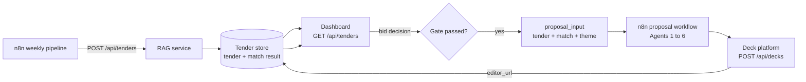

# Real tenders: from n8n to the RAG, the dashboard and the proposal generator

> Historical plan written before the integration was built. The system now runs with `docker compose up` (see the
> [README](../../README.md)); the RAG stores tenders in `tenders.json` (Docker volume `rag_state`), not SQLite.

18 October 2026 · Analysis only: nothing described in sections 4–6 is built yet.

The knowledge base is real: 19 CVs, plus company projects, tools and clients taken from the CVs and olivesoft.fr.
The tenders shown in the new frontend are **samples**. This document explains what happens when **real tenders from
the n8n pipeline** arrive, and what must be built so that they reach the dashboard and the proposal generator
(`docs/team/README_agents.md`).

---

## 1. What happens today, step by step

```text
n8n weekly run
  → LLM Tender Analysis (relevance_score, sector, requirements)
  → Build RAG Payload  (only if relevance_score >= 40 and at least one requirement)
  → Call RAG: POST /retrieve/tender  ──►  RAG matches in Company mode (about 1–2 s per tender)
                                          returns matrix, fit score, team, gaps, evidence
  ✗ nothing reads the response: n8n has no node after "Call RAG"
  ✗ nothing is stored: the RAG keeps no history of tenders
  ✗ the dashboard shows sample JSON files, not these tenders
  ✗ the proposal generator never receives the match result
```

So with real data **the matching itself already works**, but its result is lost right away.

## 2. What already works with real tenders

| Part | Status |
|---|---|
| n8n payload contract (`tender_id, client, sector, requirements{technical, team, experience}`) | Accepted by `POST /retrieve/tender` (`services/rag/rag/api.py`, `TenderRecord`) |
| Extra fields (`language`, `title`, `deadline`) from the updated `Build RAG Payload` | Accepted without error, but **ignored** (see 3.2) |
| French requirements | Multilingual embedding and reranker, plus French aliases in `rag/taxonomy.py` |
| Sector strings such as "Public administration (local government)" | Matched to `public` through the word "government" |
| Output | Requirements matrix, fit score (5 categories), evidence quotes, proposed team, knowledge gaps, warnings |
| Data mode | Company by default: CVs plus company records. Correct for real tenders. |

## 3. What will go wrong or be weak with real data

| # | Problem | Effect |
|---|---|---|
| 3.1 | **The response is not stored.** n8n ignores it and the RAG keeps nothing. | No history, no dashboard, no proposal input. Tenders re-sent each week cannot be updated in place. |
| 3.2 | `title`, `deadline` and `language` are dropped by the RAG (only `tender_id` is echoed back). | The result cannot be shown or used without joining it back to the n8n export. |
| 3.3 | LLM-written requirements can be vague ("Hébergement conforme RGPD") or use words missing from the vocabulary (RGPD/GDPR, iOS, Android, ITIL processes…). | Those requirements fall to the reranker and come out **partial or missing more often**. The fit score drops for wording reasons, not real gaps. |
| 3.4 | Sector strings the vocabulary does not know. | Warning "Sector not recognised"; domain fit is left out. |
| 3.5 | The benchmark covers the 19 CVs only. | Quality on real tenders is **not measured** yet. |
| 3.6 | The frontend reads static files (`apps/web/src/lib/data.ts` → `src/data/*.json`). | Real tenders do not appear. |
| 3.7 | n8n in Docker on Linux. | `host.docker.internal` does not exist unless the container is started with `--add-host=host.docker.internal:host-gateway`. The RAG must listen on `0.0.0.0` (`./start.sh` already does). |
| 3.8 | **Gate mismatch.** n8n sends tenders with relevance ≥ 40. The proposal agents start when "the match is above 85%". | Nobody has defined which score (n8n relevance or RAG fit) starts the proposal, or who triggers it. |
| 3.9 | Proposal input fields with **no source today**: `project_type`, `raw_text_excerpt`, project `duration_months`, the pricing catalog. Also, many company projects have unnamed clients. | The agents must write `[TO FILL: …]`; they must never invent these values. |

## 4. Target flow



1. n8n sends each relevant tender, with buyer profile and raw text, to `POST /api/tenders`.
2. The RAG runs the matching, stores the tender and its result, and upserts on `tender_id`.
3. The dashboard lists stored tenders. The workspace shows requirements, team, gaps and the Prospect tab (from `buyer_profile`).
4. When the gate passes (automatically, or when the bid manager clicks "Bid"), the RAG builds `proposal_input`.
   n8n sends it to the proposal workflow.
5. The deck platform returns `editor_url`. It is saved on the tender and shown in the Proposal tab.

## 5. Mapping RAG output to the proposal generator input

Proposal input format: `docs/team/README_agents.md` §4.1.

| Proposal field | Source | Notes |
|---|---|---|
| `tender.id, title, client, language, deadline` | n8n payload, stored with the tender | Needs 3.2 fixed |
| `tender.project_type` | n8n LLM analysis (new field) | `software`, `saas` or other; decides the class diagram |
| `tender.requirements[]` | technical + team + experience, flattened | Keeps the tender's language |
| `tender.raw_text_excerpt` | n8n `raw_text` (new field, trimmed) | Not sent today |
| `match.score` | `fit_score.overall / 100` | See the gate decision in section 7 |
| `match.similar_projects[]` | `matches` where `type = past_project` | name = title; client (unnamed → `[TO FILL]`); year; result = outcomes; stack = technologies; team_size = number of assigned engineers; duration_months = `[TO FILL]` until records have it |
| `match.why_us[]` | Covered requirements with their evidence, plus matching stacks and tools | One fact per line, with its source |
| `match.certifications` | Certificates asked by the tender and found in the CV bank | `matching` = count, `list` = names |
| `match.engineers` | `team_proposal` (roles and counts) and the number of qualifying CVs | `specialized` = qualifying CVs |
| `theme` | Design tokens (`docs/design/Product_UX_and_Design_System.md`) | Blue `#2557F2`, olive `#6B8E23`, Inter |
| Pricing | `pricing_catalog.json` (Person 5) | Real OliveSoft rates needed; the RAG has none |

**Prospect tab:** n8n `buyer_profile` (sector, scale, past digital projects, key partners, domain requirements) maps
directly onto the Person 3 schema already used by the Prospect tab.

## 6. What to implement

### RAG service (Dali)

| Priority | Item |
|---|---|
| 1 | `POST /api/tenders`: store the tender + run matching + save the result (SQLite in `RAG/state/`), upsert on `tender_id` |
| 1 | `GET /api/tenders` (list) and `GET /api/tenders/{id}` (tender, result, status, `editor_url`) |
| 1 | Keep and return `title`, `deadline`, `language` in the result |
| 2 | `rag/proposal_input.py` + `GET /api/tenders/{id}/proposal-input`, following section 5, with `[TO FILL]` for unknown facts |
| 2 | Log the words in requirements that the vocabulary does not know; add the frequent ones to `rag/taxonomy.py` (RGPD/GDPR, iOS, Android…) |
| 3 | Benchmark: a set of real tender requirements with expected results (projects and CVs) |
| 3 | Optional `duration_months` field on project records |

### n8n (Persons 1 and 2)

| Priority | Item |
|---|---|
| 1 | Apply the updated `Build RAG Payload` (adds `language`, `title`, `deadline`) |
| 1 | Point it at `POST /api/tenders`; also send `raw_text_excerpt`, `project_type`, `buyer_profile`, `relevance_score` |
| 2 | Read the response; when the gate passes, call the proposal workflow with `proposal_input` |
| 2 | Save `editor_url` back to the tender (`PATCH /api/tenders/{id}`) |

### Proposal generator (Person 5)

- Accept `proposal_input` as defined in section 5.
- Keep the "use only given facts, else `[TO FILL]`" rule. Unnamed clients and missing durations must stay visible gaps.
- Provide `pricing_catalog.json` with real OliveSoft rates.

### Frontend

- Replace the static files in `apps/web/src/lib/data.ts` with calls to `/api/tenders`, `/api/documents`, `/api/records` and `/api/benchmark`.
- Add Bid / No-bid actions on the tender, and show the `editor_url` and deck status in the Proposal tab.
- Make "New analysis" call `POST /api/tenders` (manual tenders use the same path as n8n).
- Serve the built frontend from the RAG service on port 8001.

## 7. Open decisions for the team

1. **Proposal gate:** RAG fit ≥ 85, n8n relevance ≥ 85, or a manual "Bid" click? (Recommended: manual Bid, with fit shown as guidance.)
2. **Where tenders live:** RAG SQLite store (recommended: one place for the dashboard) or the n8n Google Sheet.
3. **Who calls the proposal workflow:** n8n (recommended: it already orchestrates) or the RAG.
4. **First real run:** Company mode only (recommended), so fictional demo records never reach a real proposal.

## 8. Test plan for the first real run

1. Export 5 analysed tenders from the n8n master JSON.
2. Replay them through `POST /retrieve/tender` and note the time for each.
3. For each requirement, compare the RAG status (covered / partial / missing) with a human reading of the knowledge base.
4. List requirements that fail because of wording, then add the missing words to the vocabulary and run again.
5. Keep these 5 tenders as the first "real tender" benchmark set.
