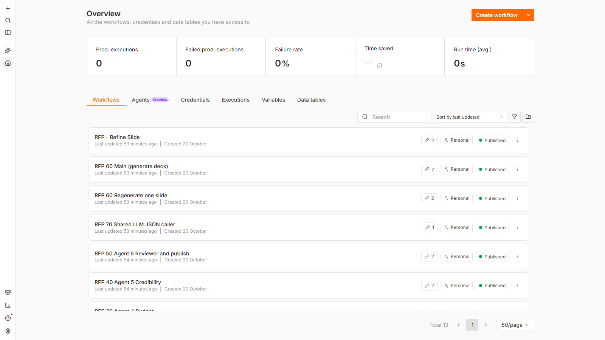
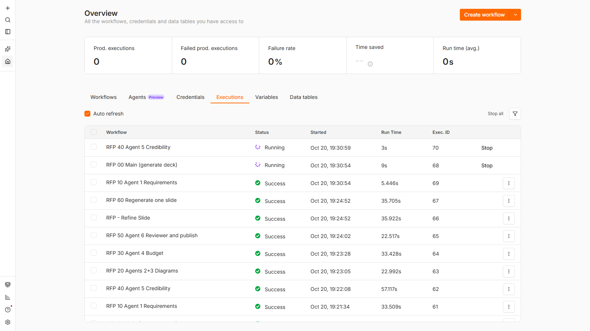

# n8n pipeline

The tender pipeline: finds tenders, analyses them with an LLM and checks the answer in code, researches buyers and
markets, calls the RAG service, ranks the results and hands the best tenders to the proposal studio. Also holds the
**Refine Slide** webhook used by the web app's "Refine with AI".


*`RFP - Main` in the n8n editor: discovery, cleaning and analysis, buyer research, RAG, market study, then ranking and hand-off to the studio.*

## Layout

| Path | Contents |
|---|---|
| [src/main/](src/main/) | Code nodes of `RFP - Main`, one file per node (prefix = lane: `API`, `URL`, `AN` analysis, `BU` buyers, `RG` RAG, `MK` market, `EX` export, `PR` proposal) |
| [src/tools/](src/tools/), [src/refine/](src/refine/) | Tool sub-workflows of the agents; the Refine Slide nodes |
| [build.js](build.js) | Builds the 4 workflows of [dist/](dist/) from `src/` (run it after editing `src/`) |
| [init/](init/) | Container start: writes credentials from the environment, imports and publishes workflows |
| [llm.json](llm.json) | Provider → default model table used by `LLM_PROVIDER` |
| [demo/](demo/) | Synthetic tenders served by the `demo-tenders` container |
| [test/](test/) | Edge-case suite, studio adapter test, replay and end-to-end harnesses |

The deck agents' 9 workflows are not here: they live in [services/proposal-studio/workflows/](../services/proposal-studio/workflows/)
and are imported by the same init script.

## Run and test

The container is built and configured by `docker compose up` (see [docs/setup.md](../docs/setup.md#how-n8n-starts)).
Open http://localhost:5679, then run **RFP - Main** with **Execute workflow**.

```bash
node build.js                 # regenerate dist/ after editing src/
node test/edge_cases.js       # 223 cases on the built Code nodes, no n8n or network needed
```

Docker-only variants of these commands: [tests/README.md](../tests/README.md).

| | |
|---|---|
|  |  |
| The 13 imported workflows after start | A deck generation and a slide refinement, agent by agent |

## Further reading

- [docs/n8n-pipeline.md](../docs/n8n-pipeline.md): what each stage does, the three agents, demo mode
- [docs/architecture.md](../docs/architecture.md): every node and the data flow
- [docs/edge-cases.md](../docs/edge-cases.md): the edge-case suite and the gaps it found
