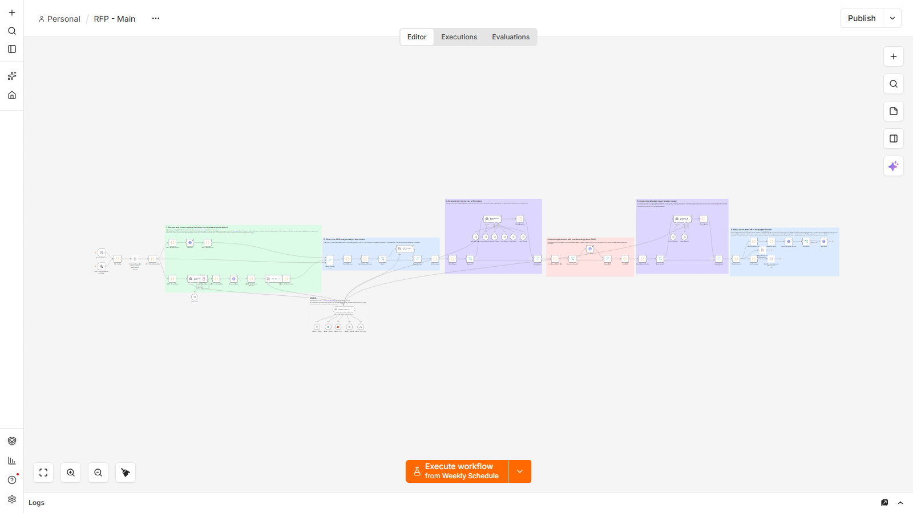
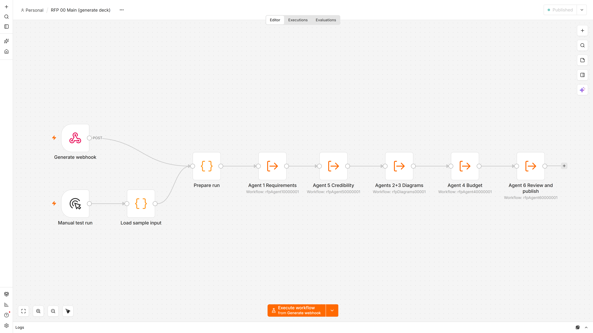
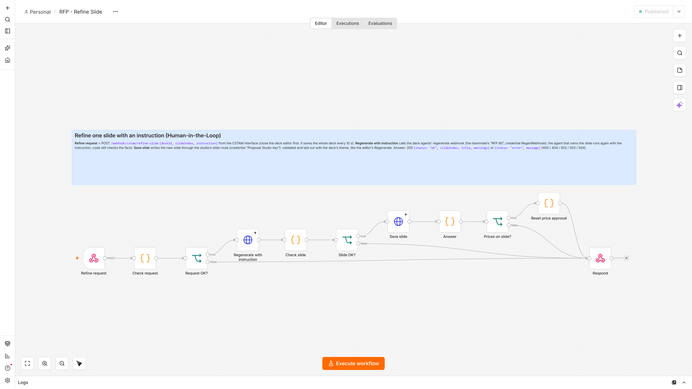

# n8n pipeline

The tender pipeline. It finds tenders, analyses them with an LLM and checks the answer in code, researches buyers and
markets, calls the RAG service, ranks the results and hands the best tenders to the proposal studio. This folder also
holds the **Refine Slide** webhook behind the web app's "Refine with AI".



`RFP - Main` has six stages. Each stage is a coloured group on the canvas, with an explanation note:

| Stage | Screenshot |
|---|---|
| 1. Discover and extract tenders (API lane and URL lane with the Tender Scout Agent) | [view](../docs/screenshots/n8n-main-1-discover-and-extract-tenders-two-lanes-o.png) |
| 2. Clean, then one analysis call per kept tender | [view](../docs/screenshots/n8n-main-2-clean-then-one-analysis-call-per-kept-te.png) |
| 3. Research only the buyers of fit tenders (Buyer Research Agent) | [view](../docs/screenshots/n8n-main-3-research-only-the-buyers-of-fit-tenders.png) |
| 4. Match requirements with the knowledge base (RAG) | [view](../docs/screenshots/n8n-main-4-match-requirements-with-your-knowledge-b.png) |
| 5. Market study (Competitor & Budget Agent) | [view](../docs/screenshots/n8n-main-5-competitor-budget-agent-market-study.png) |
| 6. Rank, export, hand off to the proposal studio | [view](../docs/screenshots/n8n-main-6-rank-export-hand-off-to-the-proposal-stu.png) |

## Deck agents and refinement

The same n8n instance runs the teammate's 9 deck-agent workflows, which live in
[services/proposal-studio/workflows/](../services/proposal-studio/workflows/). The studio calls them through webhooks.

| | |
|---|---|
|  |  |
| **RFP 00 Main (generate deck):** Agent 1 requirements, Agent 5 credibility, Agents 2+3 diagrams, Agent 4 budget, Agent 6 review and publish | **RFP - Refine Slide:** validates the request, has the owning agent rewrite the slide, saves it, and resets the price approval when the slide has prices |

More screenshots: [Agent 6 reviewer](../docs/screenshots/n8n-deck-agent6-reviewer.png),
[regenerate one slide](../docs/screenshots/n8n-deck-regenerate-slide.png),
[the 13 published workflows](../docs/screenshots/n8n-workflows.png), and
[the executions of one deck run](../docs/screenshots/n8n-executions.png).

## Layout

| Path | Contents |
|---|---|
| [src/main/](src/main/) | Code nodes of `RFP - Main`, one file per node. The prefix names the stage: `API`, `URL`, `AN` (analysis), `BU` (buyers), `RG` (RAG), `MK` (market), `EX` (export), `PR` (proposal) |
| [src/tools/](src/tools/), [src/refine/](src/refine/) | The agents' tool sub-workflows; the Refine Slide nodes |
| [build.js](build.js) | Builds the 4 workflows in [dist/](dist/) from `src/`. Run it after editing `src/` |
| [init/](init/) | Container start: writes credentials from the environment, applies `.env` settings, imports and publishes the workflows |
| [llm.json](llm.json) | Table mapping each provider to its default model, used by `LLM_PROVIDER` |
| [demo/](demo/) | Demo tenders (fictional tenders with real public bodies as buyers), served by the `demo-tenders` container |
| [test/](test/) | Edge-case suite, studio adapter test, replay and end-to-end harnesses |

## Run and test

`docker compose up` builds and configures the container. Open http://localhost:5679, then run **RFP - Main** with
**Execute workflow**. Settings such as `PIPELINE_DEMO_MODE`, `PIPELINE_PRESET` and `LLM_PROVIDER` are read from
`.env` at each start ([.env.example](../.env.example)).

```bash
node build.js                 # regenerate dist/ after editing src/
node test/edge_cases.js       # 223 cases on the built Code nodes; no n8n or network needed
```

Docker-only variants of these commands are in [tests/README.md](../tests/README.md).

## Further reading

- [docs/n8n-pipeline.md](../docs/n8n-pipeline.md): what each stage does, the three agents, the proposal input
- [docs/architecture.md](../docs/architecture.md): every node and the data flow
- [docs/edge-cases.md](../docs/edge-cases.md): the edge-case suite and the gaps it found
